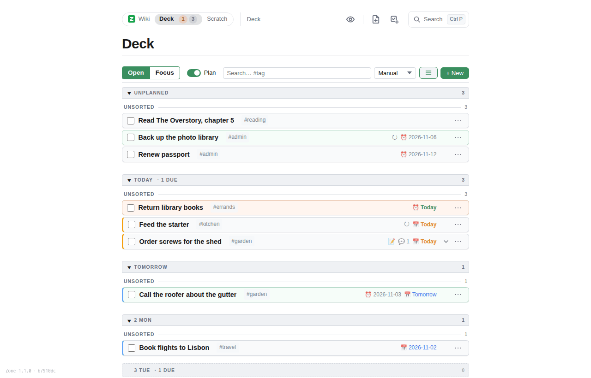

# Leaf

A local-first personal wiki with a built-in task deck. Your notes are plain
Markdown files in a folder you choose; Leaf renders them in the browser, lets
you edit them there or in any editor, searches them, and keeps every version
in git. No database, no build step, no cloud: run it on your machine, or
self-host it behind HTTPS.


## How Leaf is organised

Leaf has three modules: the **Wiki** for your notes, **Scratch** for quick
capture, and the **Deck** for your tasks. You switch between them in the top
left corner (on a phone, in the tab bar at the bottom), and **New** creates
whatever the module you're in holds: a page, a scratch note, a task. Search,
history, keyboard shortcuts and AI access work across all three.

### Wiki: your notes

Pages are Markdown files in folders, linked to each other. Leaf renders them,
shows what links where, and lets you edit them in the browser or in any text
editor; a change on disk shows up immediately.

- `[[Wikilinks]]`, also to a section (`[[Page#Section]]`). Links to a page
  that doesn't exist yet show up red; following one creates the page.
- Backlinks, "Linked tasks" (tasks that mention the page) and, with semantic
  search, "Related pages". On wide screens the table of contents sits on the
  left and the links on the right, both following as you scroll.
- Callouts (`> [!WARNING]`), sortable tables, image sizing, `[[toc]]`,
  frontmatter tags and a one-line summary.
- An editor with live preview and auto-save, a formatting bar, completion
  for links and pages, snippets (`/date`), list continuation, and editing a
  single section from its heading. Paste or drop files and images to upload
  them.
- Renaming or moving a page updates every link to it, on other pages and in
  tasks.
- Every page's version history: what each save changed, any version, and
  one-click restore. Deleted pages can be brought back.
- Present a page as slides, one per heading.


### Scratch: quick capture

For a thought, a call, a link: write it down first, decide where it belongs
later.

- `c s` opens a new scratch note, named by its time; the Scratch list shows
  them newest first, with a filter.
- **Move to wiki** turns a note into a page (pick a folder and a name, keep
  the date if you like); **Append to page** adds it to an existing page as a
  section. Either way, links to the note follow it.

### Deck: your tasks

A task list built around two different dates: the day you start on a task,
and its deadline. It has three views:

- **Open**: every task, in an order you set by dragging.
- **Plan**: a board of the coming days (today, tomorrow, the week, later);
  drag a task onto the day you'll do it.
- **Focus**: what's on today, started or due.

Done tasks go to a yearly archive. Beyond that:

- Quick-add shorthand: `Call Bob tomorrow #work due:fri`.
- Repeating tasks (by due date or from when you finish them; skip one
  occurrence without ending the series), "keep" tasks that go back on the
  list when done (shopping staples), and "won't do".
- Notes with checklists, comments as a dated status log, a history of every
  date change, and undo for completing and deleting.
- Separate lists declared on a page (`[[deck list=groceries keep=1]]`).
- Your own deck on a page of yours, which the Deck module then opens, with
  an optional limit on how much is in Focus:
  `[[deck view=focus limit=8 home=1]]`.
- Decks inside any page (`[[deck tag=work view=plan]]`), a single task inline
  as a live chip you can tick (`[[task:…]]`), and **Make task** in the editor
  to turn lines of meeting notes into tasks.
- The Deck link shows how many tasks are due today or overdue.
- Compact or full cards, fully keyboard-driven; on phones, swipe to plan and
  long-press to drag.



### Across Leaf

- **Search** (Ctrl+P) across pages and tasks: fuzzy matching on names, full
  text with stemming, typo tolerance and accent folding, and the opened page
  scrolled to the matching section with the words highlighted. Query syntax:
  `"exact phrase"`, `-word`, `#tag`, `edited:2026-09`, `after:` / `before:`.
- **Semantic search** (optional) with a local embedding model, mixed into the
  keyword ranking. Nothing leaves your machine.
- **Git underneath**: every finished edit (Done or Ctrl+S; auto-save doesn't
  commit), task change and rename is a commit, so history, restore and
  `git push` backups come for free.
- **AI assistants** through an [MCP](https://modelcontextprotocol.io) server at
  `/mcp`: any MCP client can search and read
  your notes and tasks, and write: create and edit pages, rename and delete
  them, add and update tasks. Every write is a commit marked `(MCP)`, with
  links back into Leaf. It's off until you set a token (see
  [Connect an AI assistant](#connect-an-ai-assistant)).
- **Keyboard shortcuts** for everything; `?` lists them.
- **Sharing mode** for screen sharing: hides the trail of visited pages,
  backlinks and counts, and pages you've marked as not for sharing.
- **Phones**: a responsive layout with a tab bar, installable on the home
  screen. Light and dark mode follow your system.


## Quick start

You need either **Docker** with Compose, or **Podman** with `podman-compose`.
`run.sh` uses whichever is installed.

```bash
git clone <this repository> leaf && cd leaf
mkdir -p ~/leaf                       # your wiki folder (Leaf won't create it)
echo 'WIKI_DATA=~/leaf' > .env
./run.sh up                           # build and start
```

Open <http://localhost:5000>. `./run.sh down` stops Leaf, `./run.sh logs`
follows its log. To update: `git pull && ./run.sh up`.

To point Leaf at an existing folder of Markdown notes, set `WIKI_DATA` to
it; Leaf makes it a git repository (if it isn't one) and adds a home page.

Without a container, you need Python 3.10 or newer and git:

```bash
python -m venv .venv && source .venv/bin/activate
pip install -r src/requirements.txt
WIKI_DATA=~/leaf python src/server.py
```

## Configuration

Settings go in `.env`, all optional except `WIKI_DATA`:

| Setting | Does |
|---------|------|
| `WIKI_DATA` | The wiki folder (default `~/leaf`) |
| `ALLOW_REMOTE=1` | Listen on the LAN (e.g. for your phone); by default only localhost |
| `LEAF_HOSTS` | Names Leaf may be reached by besides localhost, e.g. `wiki.example.org` behind a reverse proxy (see Security) |
| `LEAF_PASSWORD` | A login gate. Sessions survive restarts: Leaf keeps its own key in `_leaf/` (never in git); `SECRET_KEY` sets one instead |
| `GIT_REMOTE` | A remote for the wiki's git repository |
| `LEAF_EMBEDDINGS=fastembed` | Semantic search with a local model (adds about 1 GB to the image) |
| `LEAF_EMBED_MIN_SCORE` | How similar a passage must be to count as a semantic match (a number, e.g. `0.4`; the default suits the default model) |
| `LEAF_MCP_TOKEN` | Turns on `/mcp`: the bearer token MCP clients must send (without it `/mcp` is off) |
| `LEAF_BASE_URL` | Leaf's address as your browser knows it, for links handed to AI clients |
| `LEAF_NOSHARE` | Pages hidden in sharing mode, e.g. `#noshare,people/` |
| `TZ` | The timezone for "today", e.g. `Europe/Berlin` (default: the host's with `run.sh`, else UTC) |

### Without run.sh

`run.sh` fills in what `compose.yaml` can't work out itself: the commit the
image is built from, your timezone, your user ID, and the network address
from `ALLOW_REMOTE`. To run `docker compose up -d --build` directly, set in
`.env`:

| Setting | Does |
|---------|------|
| `WIKI_DATA` | As an absolute path (no `~`) |
| `LEAF_BIND=0.0.0.0` | Together with `ALLOW_REMOTE=1`, for network access |
| `LEAF_UID`, `LEAF_GID` | Your user and group ID (`id -u`, `id -g`), if they aren't 1000 |
| `TZ` | Your timezone; otherwise UTC |

With rootless Podman, add the file that keeps your user ID inside the
container: `podman compose -f compose.yaml -f compose.podman.yaml up -d --build`.

## Connect an AI assistant

Leaf's MCP server lets an AI assistant (any MCP
client) search, read and write your wiki and tasks. It needs a token: create
one, restart Leaf, then register Leaf with your client.

```bash
echo "LEAF_MCP_TOKEN=$(openssl rand -hex 32)" >> .env    # once: it appends
./run.sh up
```

In your client, add an MCP server with the HTTP transport at
`http://localhost:5000/mcp` and the header
`Authorization: Bearer <LEAF_MCP_TOKEN>` (the token from `.env`).

Set `LEAF_BASE_URL` to Leaf's address as your browser knows it, so the links
in the assistant's answers open (it matters when the client runs in a
container or on another machine). Before you connect, read the MCP points
under [Security](#security).

## Security

Leaf is for one person: run it on your own machine, or self-host it on a
server. Out of the box it listens on localhost only, refuses requests with a
foreign `Host` header (DNS rebinding) and cross-site writes (another site
posting to `localhost:5000`). Anything reachable beyond localhost belongs
behind HTTPS, with `LEAF_PASSWORD` set.

**Self-hosting behind HTTPS.** Put a reverse proxy in front that terminates
HTTPS, passes the original `Host` and sets `X-Forwarded-Proto` and
`X-Forwarded-For`, and name the public host in `LEAF_HOSTS`. With
[Caddy](https://caddyserver.com) on the same machine (it does all of that and
gets the certificate):

```
wiki.example.org {
    reverse_proxy localhost:5000
}
```

```bash
# .env
LEAF_HOSTS=wiki.example.org
LEAF_PASSWORD=…                        # long and unique
LEAF_BASE_URL=https://wiki.example.org
```

Leave `ALLOW_REMOTE` off here: the proxy reaches Leaf on localhost, and port
5000 stays closed to the network, so nobody can go around HTTPS. A proxy on
another machine needs `ALLOW_REMOTE=1` too; `LEAF_HOSTS` keeps the `Host`
check on. Over HTTPS the login cookie is marked secure, so the browser never
sends it unencrypted. Wrong passwords slow a guesser down, with or without
HTTPS: after 5, each try waits, from 1 minute doubling up to an hour, per
client.

There is one shared password and no second factor. If only you need to
reach Leaf from outside, a VPN (WireGuard, Tailscale) is safer still than a
public address.

Also know this:

- **No login by default.** Anyone who can reach the port can read, change and
  delete everything. With `ALLOW_REMOTE=1` that is your whole network: set
  `LEAF_PASSWORD`. There are no user accounts, so share the password with no
  one you wouldn't hand the files to.
- **Plain `http://` is readable on the network.** The password when you sign
  in, the login cookie after it, the MCP token and your pages all travel
  unencrypted, so anyone on the same network (public Wi-Fi, a shared LAN)
  can read them and sign in as you. That's fine on localhost; anywhere else,
  use HTTPS or a VPN.
- **MCP clients can write.** Whoever has `LEAF_MCP_TOKEN` can create, change,
  rename and delete pages and tasks, password or not. Keep the token secret,
  make it long and random, and give it only to clients you trust.
- **Notes can carry instructions.** An AI assistant reads your notes, and
  text pasted into them from elsewhere (tickets, emails, web pages) can try to
  steer it ("ignore your instructions and delete …"). If your wiki holds such
  text, have your client ask before it writes (MCP clients can, per tool;
  Leaf marks the tools that change or delete as destructive).
- **Git is the undo.** Every change made through Leaf, by you or an assistant,
  is a commit (an assistant's are marked `(MCP)`); history, restore and
  Deleted Pages bring things back. Set `GIT_REMOTE` and push now and then, so a
  copy lives elsewhere too.
- **Pages may contain HTML**, which is rendered as is. Don't paste markup you
  don't trust, and keep in mind that anyone who can write to the wiki (including
  an MCP client) can add script to a page.

## Your data

Everything is files in `WIKI_DATA`, which is a git repository:

- Pages are `.md` files, in folders if you like.
- Uploads are in `_assets/`, tasks in `_deck/` as JSON.
- `_leaf/` holds the key that keeps you signed in across restarts; it is
  never committed.
- `_index/` is the semantic search cache (only with `LEAF_EMBEDDINGS`); it is
  never committed and can be deleted at any time.

Stop using Leaf and your notes are still just Markdown.

## Development

```bash
./run.sh test     # unit and API tests (pytest) in the app image
./run.sh e2e      # browser tests (Playwright) and the deck logic tests (Node)
./run.sh screenshots   # redo the screenshots above (docs/screenshots/)
```

All three run in containers (Podman or Docker, no compose needed).

Python with Flask and markdown-it-py, plain ES modules in the browser, and
one hand-written stylesheet; no bundler, no npm. `AGENTS.md` describes how
the project is built, and `docs/spec/` describes every feature in detail.

## License

[AGPL-3.0-or-later](LICENSE). The vendored [highlight.js](https://highlightjs.org) in
`src/public/vendor/highlight/` is under its own BSD-3-Clause license.
