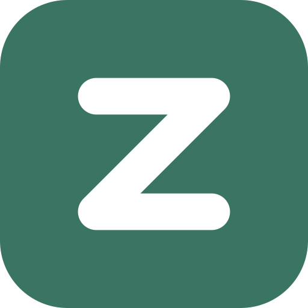
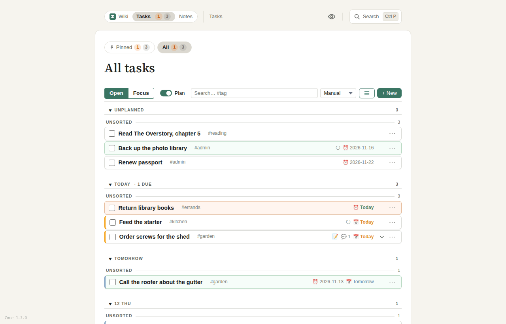
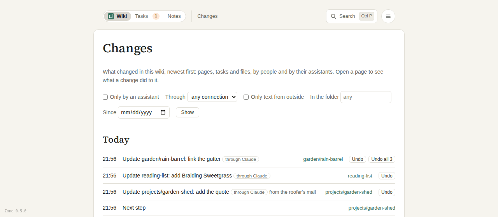
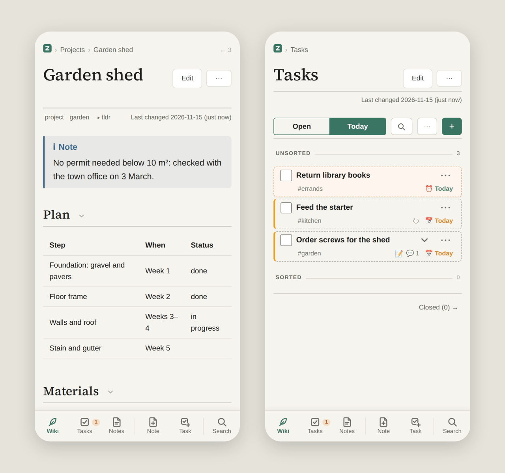

# Zone

**A wiki with tasks that you, your team and your AI assistants share, in plain files you own.**

Zone is a self-hosted **wiki** with a **real task manager** and **quick notes** built in, for **one person** or **a team**.
Your pages are plain **Markdown files** in a folder you choose, and every change is a **git** commit.
Edit them in the browser or in any editor.
Any **AI assistant** that speaks MCP can [work with them](#connect-an-ai-assistant) on your behalf.
It sees and changes only what you are allowed to, and you can review and undo every edit it makes.
One binary, no database, no outside services: Zone sends nothing anywhere on its own.

**[Try the demo](https://demo.zonewiki.org)**: sign in as `demo` with the password `zonewiki-demo`.
It is one wiki that every visitor shares and that is put back every hour, so write nothing private there.
You can connect your own AI assistant to it too: its home page says how.

[](https://github.com/zonewiki/zonewiki/actions/workflows/ci.yml)
[](https://github.com/zonewiki/zonewiki/releases/latest)
[](LICENSE)

> [!NOTE]
> **Zone is an alpha (0.x).**
> Your pages stay readable without Zone.
> Until 1.0, how tasks are stored, the settings file's keys, the MCP tools and URLs may still change; the release notes say what to do when they do.
> Read the release notes before upgrading, and keep a backup of your wiki (it is a git repository, so a copy of the folder is enough).
> From 1.0, a newer Zone will upgrade an older wiki by itself.
>
> Zone's code is written by AI coding agents, directed by one developer and held to a spec and to tests: [How Zone is made](#how-zone-is-made) says what that means for you.




## Why Zone

- **Your files stay yours.** Pages are Markdown, tasks are JSON beside them, history is git. Any tool can read them: grep them, back them up with `git push`. If you ever stop using Zone, you lose nothing.
- **A real task manager, not just checkboxes in a page.** Plan your days on a board, keep the day you'll work on a task apart from its deadline, and give tasks lists, repeats, assignees and comments. It can replace the separate task app you run beside your notes, and tasks and pages link to each other.
- **Assistants on your terms.** What you do in the browser, an assistant does over MCP: what you can, never more. Connect one that only reads, or keep it out of your private pages. Its edits are marked, and you undo them one at a time or all at once. Zone brings no model of its own: use the assistant you already have, or none.
- **For one person or a team.** Each user has private pages and tasks, groups get their own folders, and one permission model decides who sees what: in the browser, in search and for assistants alike.
- **Simple to run.** One binary on a laptop, a NAS or a server; no database, no plugins, no npm.



## Features

**Wiki.** `[[Wikilinks]]`, backlinks and red links to pages not written yet.
An editor with live preview, auto-save and a formatting bar. Two people can edit one page at once, and what they type merges.
Math, Mermaid diagrams, callouts, sortable tables and foldable sections.
Every version of every page with one-click restore, a wiki-wide Changes view, deleted pages brought back, and links that follow a rename.
Present a page as slides, or print it.

**Tasks.** A task app in its own right: Today shows what you planned for today, and on the plan board you drag the rest onto the days ahead.
A start date (when you'll do it) and a deadline (when it must be done), kept apart: only a missed deadline is overdue.
Lists, repeating tasks, quick-add (`Call Bob tomorrow #work due:fri`), Markdown descriptions with subtasks, comments and files.
Assignees, followers and `@mentions`, with news by mail if you want it.
Turn lines of a page into tasks, and embed a task list or a single task in any page.

**Notes.** Write a thought down first (`c n`), then move it into the wiki or append it to a page later.

**Search.** One full-text search across pages and tasks (Ctrl+P): typo tolerance, `"phrases"`, `#tags` and dates.

**Assistants.** Over MCP, an assistant searches, reads and writes pages, notes and tasks on your behalf.
History shows which changes it made ("Anna through Claude"), and you undo them one at a time or all at once.
A `wiki-guide` page tells every assistant your conventions, and you can limit what it reaches.

**Teams.** Several users can have their own logins, private pages and tasks, group folders and roles (admin, editor, viewer); invite people with a link, or let them sign up.
Changes are committed in each user's name.
A wiki can also be public, to read or to edit.

**Everywhere.** Keyboard shortcuts (`?` lists them), light and dark mode, and a phone layout you can install on the home screen.

<p align="center"></p>

## What Zone is not

Zone is the wrong tool, at least today, when you need:

- a desktop app with nothing to host, or your notes offline: Zone is a server and a browser, and needs the server in reach;
- plugins or scripting: Zone has none, on purpose;
- single sign-on (OIDC, LDAP, SAML): Zone has its own logins only;
- CalDAV, or a native phone app: on a phone Zone is a web page you can put on the home screen;
- something many organisations already run: Zone is an alpha by one developer.

## Quick start

To look before you install anything, there is [the demo](https://demo.zonewiki.org) (`demo` / `zonewiki-demo`).

Three ways to run Zone: the binary (the quickest), a container, or built from source.
Whichever you pick, Zone is then at <http://localhost:5080>.
To start with, it is reachable only from your computer and asks for no login; [Next steps](#next-steps) says how to open it to your phone or your team.

### Binary

**Download** the file for your computer (Linux or macOS, amd64 or arm64) from the [latest release](https://github.com/zonewiki/zonewiki/releases/latest) and run it; it needs git.
On Windows, run the Linux file in WSL2: there is no Windows binary.

```bash
mv zonewiki-macos-arm64 zonewiki      # the file you downloaded
chmod +x zonewiki
./zonewiki                            # your wiki: ~/zonewiki
ZONE_DATA=~/notes ./zonewiki --init   # or: a folder of Markdown notes you already have
```

On a Mac, see [With the binary](docs/manual/self-hosting.md#with-the-binary) first: the binary isn't signed.

### Container

**With Docker or Podman** and Compose, from the prebuilt image (amd64 and arm64): no repository, no build.
It is tested on Linux, and should work on macOS and in WSL2.

```bash
mkdir -p ~/zonewiki ~/zonewiki-docker && cd ~/zonewiki-docker
base=https://raw.githubusercontent.com/zonewiki/zonewiki/main
curl -fsSL -O $base/run.sh -O $base/compose.yaml -O $base/compose.podman.yaml
chmod +x run.sh
echo 'ZONE_DATA=~/zonewiki' > .env      # your wiki folder
./run.sh up                            # ./run.sh update for a new version
```

In a checkout of the repository, the same `./run.sh up` builds the image from it instead (to change Zone, or for search by meaning): see [From the repository](docs/manual/self-hosting.md#from-the-repository).

### From source

With Go 1.27 or newer, a C compiler and git:

```bash
git clone https://github.com/zonewiki/zonewiki && cd zonewiki
(cd go && go build -o zonewiki .)
go/zonewiki                           # your wiki: ~/zonewiki
```

`CGO_ENABLED=0` builds without semantic search and needs no C compiler.

### Next steps

Settings such as `ZONE_DATA` are lines in `.env` for the container; the binary reads no `.env` and takes them as environment variables, as above.
To reach Zone from your phone or let your team in, [set a login](docs/manual/self-hosting.md#setting-a-login) and [open it to other devices](docs/manual/self-hosting.md#reaching-it-from-other-devices); on a NAS or server (Synology, a Raspberry Pi, …), see [On a NAS or server](docs/manual/self-hosting.md#on-a-nas-or-server).
All the ways are described in [Running Zone yourself](docs/manual/self-hosting.md), with [where settings live](docs/manual/self-hosting.md#where-settings-live).

## Connect an AI assistant

**By signing in** (a wiki with a login): give your assistant the address `https://your-wiki.example/mcp`.
In Claude, add it as a custom connector. In Claude Code, run `claude mcp add --transport http zone <address>`.
You sign in, click **Allow**, and it is connected as you.
Claude.ai and ChatGPT connect from their makers' servers, so they need a wiki on the internet over https; Claude Code reaches any wiki your computer does.

**With a token** (any wiki, any client): open **Connect an assistant** in the browser, or run `./run.sh config token` (`./run.sh user token NAME` with users).
Then add an MCP server at `http://localhost:5080/mcp` with the header `Authorization: Bearer <token>`.

Write your conventions on a page called `wiki-guide` (where things go, what's private, how pages are tagged), and every assistant reads them before it writes.
Assistants can also answer questions about Zone itself.
Details: [AI assistants](docs/manual/assistants.md) in the manual.

## Security

Out of the box Zone listens on localhost only, with no login.
`ZONE_ALLOW_REMOTE=1` opens it to the network, and it then asks for a login before it shows anything.
Anything reachable from elsewhere belongs behind HTTPS with a login (`./zonewiki config passwd` or `./run.sh config passwd`, or users).
HTML written in a page runs no script and loads nothing from other sites, so text an assistant copied from a malicious mail can't take over your wiki.
Read [Before you open it up](docs/manual/self-hosting.md#before-you-open-it-up) before you expose Zone, and see [SECURITY.md](SECURITY.md) to report a vulnerability.

## Documentation

**[The manual](docs/manual/README.md)** says how to use Zone, from [getting started](docs/manual/getting-started.md) to [connecting an assistant](docs/manual/assistants.md) and [running Zone yourself](docs/manual/self-hosting.md).
It is also in Zone, under **Help**.

The full rules for each feature, written for whoever builds Zone, are in the spec, [`docs/spec/`](docs/spec/), one file per area: [routes](docs/spec/routes.md), [rendering](docs/spec/rendering.md), [editor](docs/spec/editor.md), [navigation](docs/spec/navigation.md), [search](docs/spec/search.md), [tasks](docs/spec/tasks.md), [MCP](docs/spec/mcp.md), [users](docs/spec/users.md), [security](docs/spec/security.md), [deployment](docs/spec/deployment.md) and [testing](docs/spec/testing.md).

## How Zone is made

Zone is developed by Gernot Klingler, who has worked in software engineering for more than 25 years, mostly on scalable, low-level monitoring systems where security and reliability come first.
He sets the goals and the principles, decides what is built and how it should behave, and uses Zone every day: for his own notes and tasks, and to plan Zone itself.
The code, the spec and the tests are all written by AI coding agents.

**What holds it together** is in the repository, for you to judge:

- [`AGENTS.md`](AGENTS.md) holds the principles and the rules every change keeps to, and `docs/spec/` describes every feature and changes with it.
- Every change comes with tests: Go tests for the server's internals, API tests against the real server, and browser tests. CI runs them all, with benchmarks at a team's size and a secret scan of the whole history.
- Who may see or change what is decided in one place that every door asks, and the tests probe each door for what must be refused ([security.md](docs/spec/security.md) says what each protection is).
- Agents audit the code for security regularly, at different stages of development, and what they find is fixed.

**What it does not have**: a human who has read every line, or a security review by someone independent.
So treat it as the alpha it is: start on your own computer, where it is to begin with, keep it behind a login and HTTPS (or your VPN) when you open it up, and keep the backup that a git repository makes easy.
A report of what breaks is the most useful thing you can give: see [Contributing](#contributing), and [SECURITY.md](SECURITY.md) for a vulnerability.

## Contributing

Found a bug or have an idea? Open an issue; there are templates for both.
[CONTRIBUTING.md](CONTRIBUTING.md) says how a change gets in and how to run the tests.

## License

Copyright (C) 2026 Gernot Klingler.
Zone is free software under the [GNU Affero General Public License](LICENSE), version 3 or later (`AGPL-3.0-or-later`).
You can use it freely, in a company too. If you change it and others use your version over a network, offer them its source (point `sourceURL` in `go/config.go` at your copy).
Third-party components keep their own licenses: see [THIRD_PARTY_LICENSES](THIRD_PARTY_LICENSES) and the license files in `public/vendor/` (`zonewiki licenses` prints them all).
