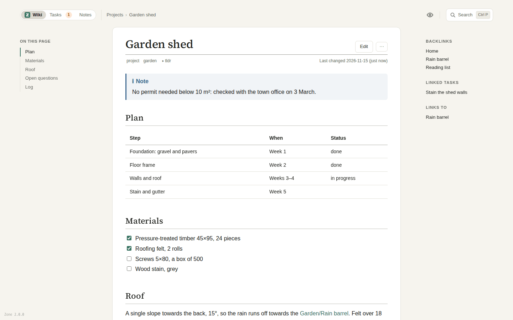

# Leaf

A self-hosted personal wiki with a built-in task deck. Your notes are plain
Markdown files in a folder you choose; Leaf renders them in the browser, lets
you edit them there or in any editor, searches them, and keeps every version
in git. No database, no frontend build, no cloud: run it on your machine, or
self-host it behind HTTPS.



## Why Leaf

**Your notes stay yours, as plain files.** Pages are Markdown in a folder you
choose, tasks are JSON next to them, history is git. Leaf renders, searches
and edits them, but nothing is locked inside it: open the folder in any
editor, grep it, back it up with `git push`, or stop using Leaf and keep
everything as it is. Search indexes and caches are rebuilt from the files.

- **Notes and tasks in one place.** The wiki and the task deck share links,
  search and history. A page can show a task as a chip, and a task can link to
  a page, with no plugins to combine.
- **Nothing gets lost.** Every page has its version history: see what each
  save changed, open any version, restore it in one click, bring back a
  deleted page. Renaming a page updates every link to it.
- **Any browser, nothing to install on the client.** Open a URL on your
  laptop or your phone; the editor works on both. The server is one Go
  binary with no database, and the frontend has no npm or bundler. It is
  small enough to read and change.
- **Your server, no cloud.** Runs on your machine by default, with no account
  and nothing loaded from other hosts. To reach it from elsewhere, put it
  behind HTTPS with a password (see [Security](#security)).
- **Supports AI-first workflows.** Through its
  [MCP server](#connect-an-ai-assistant), an AI assistant can do everything
  you can: search, read, create, edit, rename and restore pages, file scratch
  notes, and manage tasks. Its edits land as git commits marked `(MCP)` that
  you can review, diff or undo.

Leaf is for one person's notes and tasks on a server you run. It is
deliberately a single process with no plugins, no graph view and no real-time
collaboration, so it isn't a team product or a plugin platform. That keeps it
small and readable.

## How Leaf is organised

Leaf has three modules: the **Wiki** for your notes, **Scratch** for quick
capture, and the **Deck** for your tasks. You switch between them in the top
left corner (on a phone, in the tab bar at the bottom), and **New** creates
whatever the module you're in holds: a page, a scratch note, a task. Search,
history, keyboard shortcuts and AI access work across all three.

### Wiki: your notes

Pages are Markdown files in folders, linked to each other. Leaf renders them,
shows what links where, and lets you edit them in the browser or in any text
editor; a change on disk shows up immediately.

- `[[Wikilinks]]`, also to a section (`[[Page#Section]]`). Links to a page
  that doesn't exist yet show up red; following one creates the page.
- Backlinks, "Linked tasks" (tasks that mention the page) and, with semantic
  search, "Related pages". On wide screens the table of contents sits on the
  left and the links on the right, both following as you scroll.
- Callouts (`> [!WARNING]`), sortable tables, image sizing,
  frontmatter tags, a one-line summary and sources.
- An editor with live preview and auto-save, a formatting bar, completion
  for links, pages and emoji (`:tada` → 🎉), snippets (`/date`), list continuation, and editing a
  single section from its heading. Paste or drop files and images to upload
  them.
- Renaming or moving a page updates every link to it, on other pages and in
  tasks.
- Every page's version history: what each save changed, any version, and
  one-click restore. Deleted pages can be brought back.
- Present a page as slides, one per heading.


### Scratch: quick capture

For a thought, a call, a link: write it down first, decide where it belongs
later.

- `c s` opens a new scratch note, named by its time; the Scratch list shows
  them newest first, with a filter.
- **Move to wiki** turns a note into a page (pick a folder and a name, keep
  the date if you like); **Append to page** adds it to an existing page as a
  section. Either way, links to the note follow it.

### Deck: your tasks

A task list built around two different dates: the day you start on a task,
and its deadline. It has two views:

- **Open**: every task. With **Plan** on, a board of the coming days
  (today, tomorrow, the week, later) where you drag a task onto the day
  you'll do it; with Plan off, one list, in an order you set by dragging.
- **Focus**: what's on today, started or due.

Done tasks go to a yearly archive. Beyond that:

- Quick-add shorthand: `Call Bob tomorrow #work due:fri`.
- Repeating tasks (by due date or from when you finish them; skip one
  occurrence without ending the series), "keep" tasks that go back on the
  list when done (shopping staples), and "won't do".
- Notes in full Markdown, written with the page editor's formatting bar and
  shown as a page shows it (checklists, tables, code, links), comments as a
  dated status log, a history of every date change, and undo for completing
  and deleting.
- Separate lists declared on a page (`[[deck list=groceries keep=1]]`).
- Your own deck on a page of yours, which the Deck module then opens, with
  an optional limit on how much is in Focus:
  `[[deck view=focus limit=8 home=1]]`.
- Decks inside any page (`[[deck tag=work view=plan]]`), a single task inline
  as a live chip you can tick (`[[task:…]]`), and **Make task** in the editor
  to turn lines of meeting notes into tasks.
- The Deck link shows how many tasks are due today or overdue.
- Compact or full cards, fully keyboard-driven; on phones, swipe to plan,
  long-press to drag, or long-press and let go to select several tasks.


### Across Leaf

- **Search** (Ctrl+P) across pages and tasks: fuzzy matching on names, full
  text with stemming, typo tolerance and accent folding, and the opened page
  scrolled to the matching section with the words highlighted. Query syntax:
  `"exact phrase"`, `-word`, `#tag`, `edited:2026-09`, `after:` / `before:`.
- **Semantic search** (optional) with a local embedding model, mixed into the
  keyword ranking. Nothing leaves your machine.
- **Git underneath**: every finished edit (Done or Ctrl+S; auto-save doesn't
  commit), task change and rename is a commit, so history, restore and
  `git push` backups come for free.
- **AI assistants** through an [MCP](https://modelcontextprotocol.io) server at
  `/mcp`: any MCP client can search and read
  your notes and tasks, find every line matching a regex, check links
  (backlinks, orphan pages, broken wikilinks), and write: create and edit pages, find and
  replace across pages, rename and delete them (move whole folders), add and update
  tasks. Every write is a commit marked `(MCP)`, with links back into Leaf. It's
  off until you set a token (see [Connect an AI assistant](#connect-an-ai-assistant)).
- **Keyboard shortcuts** for everything; `?` lists them.
- **Sharing mode** for screen sharing: hides the trail of visited pages,
  backlinks and counts, and pages you've marked as not for sharing.
- **Phones**: a responsive layout with a tab bar, installable on the home
  screen. Light and dark mode follow your system.

<p align="center"></p>

## Quick start

You need either **Docker** with Compose, or **Podman** with `podman-compose`.
`run.sh` uses whichever is installed. Linux is the only tested platform.
`run.sh` should also work on macOS (its stock bash 3.2 is enough) and on
Windows in WSL2, which Docker Desktop and Podman use there anyway.

```bash
git clone <this repository> leaf && cd leaf
mkdir -p ~/leaf                       # your wiki folder (Leaf won't create it)
cp .env.example .env                  # then edit it: LEAF_DATA is your wiki folder
./run.sh up                           # build and start
```

Open <http://localhost:5000>. `./run.sh down` stops Leaf, `./run.sh logs`
follows its log. To update: `git pull && ./run.sh up`.

To point Leaf at an existing folder of Markdown notes, set `LEAF_DATA` to
it; Leaf makes it a git repository (if it isn't one) and adds a home page.

**On a NAS or server** (Synology, QNAP, a Raspberry Pi, …), you don't need
the repository: `compose.nas.yaml` runs the prebuilt image
`ghcr.io/gklingler/leaf` (amd64 and arm64). Put it next to a `.env` and run
`docker compose -f compose.nas.yaml up -d`; Leaf is then on port 5080. What
`.env` needs, and a step-by-step for Synology's Container Manager: "On a NAS
or server" in [`docs/spec/deployment.md`](docs/spec/deployment.md).

Without a container, you need Go 1.27 or newer, a C compiler (for semantic
search; `CGO_ENABLED=0` builds without it) and git:

```bash
(cd go && go build -o leaf .)
LEAF_DATA=~/leaf go/leaf
```

In Windows PowerShell: `cd go; go build -o leaf.exe .; cd ..`, then
`$env:LEAF_DATA="$HOME\leaf"; go\leaf.exe` starts Leaf. For semantic search
outside the container, onnxruntime's library must be where the loader finds
it (`docs/spec/search.md`).

## Configuration

Settings go in `.env` (`.env.example` lists them all), all optional except `LEAF_DATA`:

| Setting | Does |
|---------|------|
| `LEAF_DATA` | The wiki folder (default `~/leaf`) |
| `LEAF_ALLOW_REMOTE=1` | Listen on the LAN (e.g. for your phone); by default only localhost |
| `LEAF_HOSTS` | Names Leaf may be reached by besides localhost, e.g. `wiki.example.org` behind a reverse proxy (see Security) |
| `LEAF_PASSWORD` | A login gate. Sessions survive restarts: Leaf keeps its own key in `.leaf/` (never in git); `LEAF_SECRET_KEY` sets one instead |
| `LEAF_GIT_REMOTE` | A remote for the wiki's git repository |
| `LEAF_SEMANTIC_SEARCH=on` | Semantic search with a local model (adds about 0.7 GB to the image) |
| `LEAF_SEMANTIC_MIN_SCORE` | How similar a passage must be to count as a semantic match (a number, e.g. `0.4`; the default suits the default model) |
| `LEAF_QUERY_LOG=1` | Keep the queries AI clients send to `search_wiki` in `.leaf/queries.jsonl` (never in git), to turn into questions for `./run.sh eval` |
| `LEAF_MCP_TOKEN` | Turns on `/mcp`: the bearer token MCP clients must send (without it `/mcp` is off) |
| `LEAF_BASE_URL` | Leaf's address as your browser knows it, for links handed to AI clients |
| `LEAF_NOSHARE` | Pages hidden in sharing mode, e.g. `#noshare,people/` |
| `LEAF_LOCALE` | How dates read and the day weeks start on, e.g. `de-AT` or `en-GB` (default: US English dates, weeks from Monday). The UI's words stay English |
| `LEAF_DATE_FORMAT=iso` | Dates as `YYYY-MM-DD` (ISO 8601); weekday and month names still follow `LEAF_LOCALE` |
| `TZ` | The timezone for "today", e.g. `Europe/Berlin` (default: the host's with `run.sh`, else UTC) |

### Without run.sh

`run.sh` fills in what `compose.yaml` can't work out itself: the commit the
image is built from, your timezone, your user ID, and the network address
from `LEAF_ALLOW_REMOTE`. To run `docker compose up -d --build` directly, set in
`.env`:

| Setting | Does |
|---------|------|
| `LEAF_DATA` | As an absolute path (no `~`) |
| `LEAF_BIND=0.0.0.0` | Together with `LEAF_ALLOW_REMOTE=1`, for network access |
| `LEAF_UID`, `LEAF_GID` | Your user and group ID (`id -u`, `id -g`), if they aren't 1000 |
| `TZ` | Your timezone; otherwise UTC |

With rootless Podman, add the file that keeps your user ID inside the
container: `podman compose -f compose.yaml -f compose.podman.yaml up -d --build`.

## Connect an AI assistant

Leaf's MCP server lets an AI assistant (any MCP client) search, read and write
your wiki and tasks. It needs a token: create one, restart Leaf, then
register Leaf with your client.

```bash
echo "LEAF_MCP_TOKEN=$(openssl rand -hex 32)" >> .env    # once: it appends
./run.sh up
```

In your client, add an MCP server with the HTTP transport at
`http://localhost:5000/mcp` and the header
`Authorization: Bearer <LEAF_MCP_TOKEN>` (the token from `.env`).

The assistant can also answer questions about Leaf itself ("how do I give
the deck's tabs other names?"): it searches this README and Leaf's spec.

To give the assistant your wiki's conventions (where things go, what's
private, how pages are tagged), write them on a page called `wiki-guide`.
Leaf adds it to what the assistant is told when it connects, so it's followed
in every session and with any MCP client. For example:

```markdown
# Wiki guide

- Tickets go in `tickets/<id>`, one page each, with a `## Log` section.
- People get a page in `people/`; those pages are private: never quote them
  elsewhere.
- Tag pages with existing tags (list_tags) rather than new ones.
- Prefer extending a page over creating a new one.
```

Without the page, the assistant offers to start one when you tell it how you
like things.

A folder can have its own guide: a `CLAUDE.md` or `AGENTS.md` in it, the files
coding assistants already read, which then also work when an assistant edits the
files directly. They apply to the pages in that folder and its subfolders. A line
`@other.md` in a guide pulls in that page's text. Leaf makes sure the assistant
has read a guide before it writes: its first change under a guide is refused,
with the guide's text and an id. It then fixes its change and resends it with
the id. The assistant is also told which folders have guides, and to read
them with `read_guides` before drafting anything for the wiki; reading a guide
that way counts, so its write goes through at once. Either way, the guide's
text is sent once per conversation. When you change a guide, the old id stops working, so
the assistant sees the new version. `wiki-guide` counts as the guide for the
whole wiki.

Set `LEAF_BASE_URL` to Leaf's address as your browser knows it, so the links
in the assistant's answers open (it matters when the client runs in a
container or on another machine). Before you connect, read the MCP points
under [Security](#security).

## Security

Leaf is for one person: run it on your own machine, or self-host it on a
server. Out of the box it listens on localhost only, refuses requests with a
foreign `Host` header (DNS rebinding) and cross-site writes (another site
posting to `localhost:5000`). HTML in your pages is shown as written, but no
script in it runs: only Leaf's own code does, so a page that an AI assistant
wrote after reading a malicious mail or web page can't take over your wiki.
Anything reachable beyond localhost belongs behind HTTPS, with
`LEAF_PASSWORD` set.

**Self-hosting behind HTTPS.** Put a reverse proxy in front that terminates
HTTPS, passes the original `Host` and sets `X-Forwarded-Proto` and
`X-Forwarded-For`, and name the public host in `LEAF_HOSTS`. With
[Caddy](https://caddyserver.com) on the same machine (it does all of that and
gets the certificate):

```
wiki.example.org {
    reverse_proxy localhost:5000
}
```

```bash
# .env
LEAF_HOSTS=wiki.example.org
LEAF_PASSWORD=…                        # long and unique
LEAF_BASE_URL=https://wiki.example.org
```

Leave `LEAF_ALLOW_REMOTE` off here: the proxy reaches Leaf on localhost, and port
5000 stays closed to the network, so nobody can go around HTTPS. A proxy on
another machine needs `LEAF_ALLOW_REMOTE=1` too; `LEAF_HOSTS` keeps the `Host`
check on. Over HTTPS the login cookie is marked secure, so the browser never
sends it unencrypted. Wrong passwords slow a guesser down, with or without
HTTPS: after 5, each try waits, from 1 minute doubling up to an hour, per
client.

There is one shared password and no second factor. If only you need to
reach Leaf from outside, a VPN (WireGuard, Tailscale) is safer still than a
public address.

Also know this:

- **No login by default.** Anyone who can reach the port can read, change and
  delete everything. With `LEAF_ALLOW_REMOTE=1` that is your whole network: set
  `LEAF_PASSWORD`. There are no user accounts, so share the password with no
  one you wouldn't hand the files to.
- **Plain `http://` is readable on the network.** The password when you sign
  in, the login cookie after it, the MCP token and your pages all travel
  unencrypted, so anyone on the same network (public Wi-Fi, a shared LAN)
  can read them and sign in as you. That's fine on localhost; anywhere else,
  use HTTPS or a VPN.
- **MCP clients can write.** Whoever has `LEAF_MCP_TOKEN` can create, change,
  rename and delete pages and tasks, password or not. Keep the token secret,
  make it long and random, and give it only to clients you trust.
- **Notes can carry instructions.** An AI assistant reads your notes, and
  text pasted into them from elsewhere (tickets, emails, web pages) can try to
  steer it ("ignore your instructions and delete …"). If your wiki holds such
  text, have your client ask before it writes (MCP clients can, per tool;
  Leaf marks the tools that change or delete as destructive).
- **Git is the undo.** Every change made through Leaf, by you or an assistant,
  is a commit (an assistant's are marked `(MCP)`); history, restore and
  Deleted Pages bring things back. Set `LEAF_GIT_REMOTE` and push now and then, so a
  copy lives elsewhere too.
- **Pages may contain HTML**, which is rendered as is. Don't paste markup you
  don't trust, and keep in mind that anyone who can write to the wiki (including
  an MCP client) can add script to a page.

## Your data

Everything is files in `LEAF_DATA`, which is a git repository:

- Pages are `.md` files, in folders if you like.
- Uploads are in `_assets/`. Tasks are in `_deck/` as JSON, not Markdown: they
  have fields (dates, repeats, tags) and are written safely when several
  things change them at once. They are still plain files in the git
  repository.
- `.leaf/` is Leaf's own state, never committed: `secret_key` keeps you signed
  in across restarts, `index/` is the semantic search cache (only with
  `LEAF_SEMANTIC_SEARCH`; it can be deleted at any time).

Nothing is locked in: if you stop using Leaf, your pages are plain Markdown
files that any editor opens, with their history in git.

## Development

```bash
./run.sh test     # go vet, go test, then the API tests (pytest)
./run.sh e2e      # browser tests (Playwright) and the deck logic tests (Node)
./run.sh leaks    # scan the git history for secrets (gitleaks)
./run.sh screenshots   # redo the screenshots above (docs/screenshots/)
./run.sh eval     # measure how well search finds answers in your wiki
```

All of them run in containers (Podman or Docker, no compose needed); CI runs the same commands. To have
commits with a secret in them refused, turn on the pre-commit hook once:
`git config core.hooksPath .githooks`.

Go with goldmark for markdown, plain ES modules in the browser, and one
stylesheet; no bundler, no npm.

### How Leaf is made

Leaf is AI-engineered: its code is written by AI coding agents, carefully
guided by its maintainer, who sets the direction
and makes the design decisions. The guardrails live in the repository,
where you can check them:

- `AGENTS.md` holds the principles, constraints and conventions every change
  has to follow.
- `docs/spec/` describes every feature in detail and is updated with the
  change that alters it.
- Every feature and fix comes with tests (unit, API and browser tests),
  and the whole suite runs before and after each change.

## Contributing

Found a bug or have an idea? Open an issue; there are templates for both.
[CONTRIBUTING.md](CONTRIBUTING.md) says what a bug report needs and how a
change gets in.

## License

[AGPL-3.0-or-later](LICENSE). The vendored [highlight.js](https://highlightjs.org) in
`public/vendor/highlight/` is under its own BSD-3-Clause license; the
emoji names in `public/vendor/gemoji/` (GitHub's [gemoji](https://github.com/github/gemoji))
under MIT.
