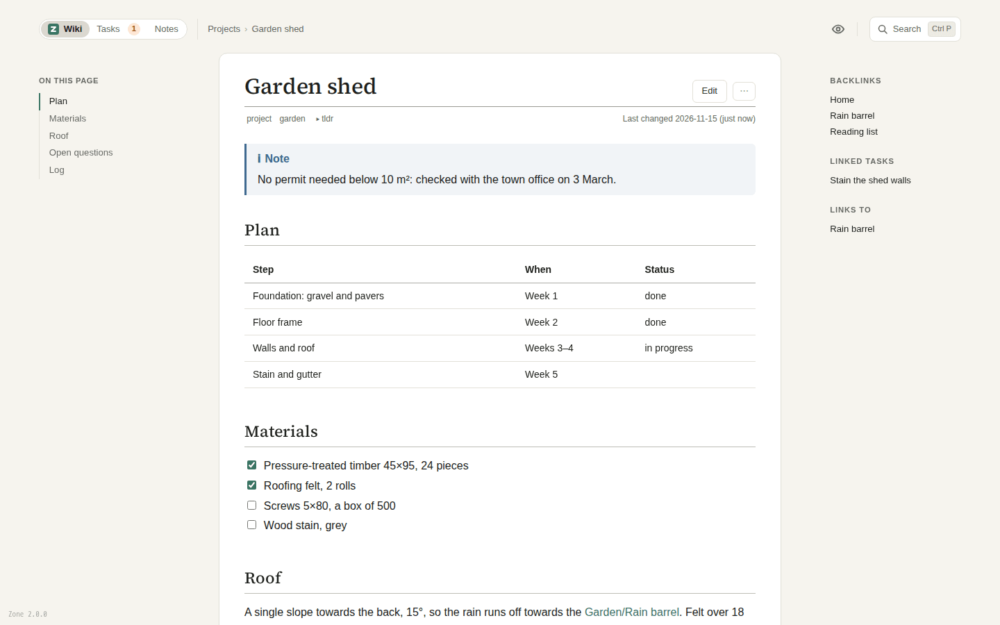

# Getting started

Your first ten minutes in Zone: what's where, your first page, a note and a task, planning your day, and how to find things again.
Everything else in this manual builds on these few steps.



## The modules

Zone has three parts, called modules.
You switch between them with the pills at the top left of every page (on a phone, with the tab bar at the bottom):

| Module | What it is |
|--------|------------|
| **Wiki** | Your pages: Markdown, linked to each other. The Z logo next to it takes you to the home page. |
| **Tasks** | A task manager of its own: what's on today, a board to plan the days ahead, lists, repeating tasks. |
| **Notes** | Quick notes, written down now and filed into the wiki later. |

In a wiki with several users there are two more:

| Module | What it is |
|--------|------------|
| **Private** | Your own pages, which only you see. |
| **Groups** | The pages of a group you're in, which only its members see. You see it only when you're in a group. |

With users, your notes are private too: only you see them until you move one into the wiki.
[Teams](teams.md) explains who sees what.

## Edit your first page

The home page is a page like any other.
Click **Edit** at its top right (or press `e`).
The editor opens with the page's Markdown, and a live preview beside it on a wide screen.

Type something, for example:

```markdown
# Home

Things I'm working on:

- [[Garden shed]]
- [[Q3 plan]]
```

Zone saves as you type.
Click **Done** (or press `Ctrl+S`) to finish: the page is shown again and the change is saved as a version you can go back to.
[Writing](writing.md) has the editor and Zone's Markdown in full.

## Link to a page not written yet

`[[Garden shed]]` is a wikilink: a link to another page by its name.
The page doesn't exist yet, so the link is shown in red with a dashed underline.
Click it, and the editor opens for the new page, ready to write.
Click **Done**, and the page exists, and the link on the home page works.

Starting a page from a link to it is the usual way in Zone: the page is linked from somewhere from the start.
[Pages](pages.md) covers folders, renaming and moving.

## Write a note

Press `c`, then `n` (on a phone, tap **Note** in the tab bar).
Give the note a title and click **Create & Edit**.
The editor opens under the title: write whatever you need to remember, then click **Done**.

The note is now in **Notes**, newest first.
Later you can give it a proper place in the wiki, or add it to a page that already exists.
[Notes](notes.md) shows how.

## Add a task

Press `c`, then `t` (on a phone, tap **Task**).
A task dialog opens, wherever you are.
Type a title, and add dates and tags at its end in plain words, called quick-add:

```text
Call Ben tomorrow #work due:fri
```

That makes the task "Call Ben", starting tomorrow, due on Friday, tagged `#work`.
The fields below the title show what Zone understood as you type.
Click **Save**: the task goes to your **Inbox**, and you stay on the page you were on.

Without a date of your own, the task starts today, so it shows up in **Today** in Tasks.
The number on the **Tasks** pill counts what's due.

## Plan your day

Click **Tasks** (or press `g`, then `t`).
**Today** shows what you planned for today, and what is due or overdue.
On **Open**, switch from **List** to **Plan**: a board with a section for each day.
Drag a task from **Unplanned** onto a day, and it's on Today when that day comes.
Tick a task's box when it's done.

Tasks can be all the task app you need: [Tasks](tasks.md) has the rest, such as lists, repeating tasks, assigning tasks in a team, and showing tasks on a wiki page.

## Find things

Press `Ctrl+P` (`⌘P` on a Mac), or click **Search** at the top right.
With nothing typed, the dialog lists your recently edited pages, so it works as a quick switcher.
Type a few letters to narrow the list by title; matches in pages' text and in tasks appear below.
Use the arrow keys and `Enter` to open one.
[Search](search.md) explains phrases, tags and dates.

## Learn the shortcuts

Press `?` anywhere to see every keyboard shortcut.
`Esc` closes the dialog.
The most useful ones to start with:

| Keys | Does |
|------|------|
| `Ctrl+P` | Search |
| `e` | Edit the page |
| `c` `n` | New note |
| `c` `t` | New task |
| `g` `h` | Go to the home page |
| `g` `t` | Go to Tasks |

## Where to go next

- [Pages](pages.md): links, folders, renaming, moving and deleting
- [Writing](writing.md): the editor and Zone's Markdown
- [Tasks](tasks.md): Today and the Plan board, lists, dates, repeating tasks and assigning
- [Notes](notes.md): filing notes into the wiki
- [Search](search.md): finding pages and tasks
- [Getting around](navigation.md): the modules, shortcuts, phones, sharing and presenting
- [History and undo](history.md): every version, and getting old ones back
- [Teams](teams.md): users, private pages and groups
- [AI assistants](assistants.md): connecting Claude, ChatGPT and others
