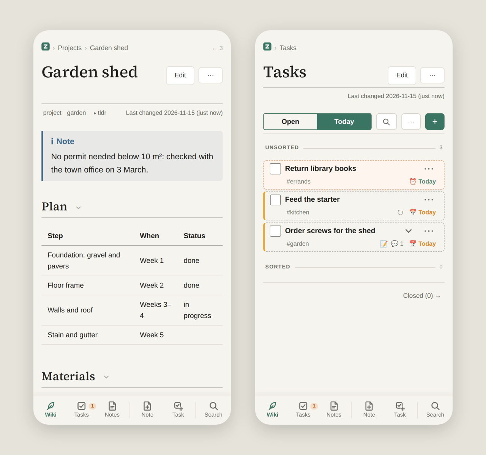

# Getting around

How to move around Zonewiki: the modules, the buttons at the top of each page, the tab bar on a phone, and the keyboard shortcuts.
It also covers showing your screen to others (Sharing mode), presenting a page as slides, printing, dark mode and installing Zonewiki on a phone's home screen.

## The module switcher

At the top left of every page are the modules, as pills: **Wiki**, **Tasks** and **Notes**.
Click one to go there; the one you're in is shaded.
The green Z in front of **Wiki** takes you to the home page.

In a wiki with users, the switcher has two pills:
the pages, **Wiki · Private**, and your tools, **Tasks · Notes**.
**Private** and **Notes** carry a small lock: only you see what's in them.
If you're in a group, **Groups** stands between Wiki and Private:

- in one group, the pill carries the group's name and goes to its home page;
- in several, it says **Groups** and opens a menu of your groups' homes, with **All your groups** at the end.

[Teams](teams.md) explains private pages and groups.

### The trail of recent pages

Next to the switcher, Zonewiki shows the pages you visited last, as a trail, so you can step back to one with a click.
When the window is narrow, the oldest pages drop out of the trail first.

When other pages link to the one you're on, a `← 3` chip at the end of the row says how many.
Point at it (tap it on a phone) to see which pages they are.
On a wide screen they're listed in the right-hand column instead, under **Backlinks**.

## Top actions

At the top right of each page, on a computer:

| Button | Does |
|--------|------|
| **Sharing** | Only while [Sharing mode](#sharing-mode) is on: turns it off |
| **Search** | Opens the search, as `Ctrl+P` does (see [Search](search.md)) |
| Your initial | With users: the user menu, with **Settings**, **Admin** (for admins), **Sharing mode**, **Help** and **Sign out** |
| Three lines | Without users: the menu, with **Settings** (while the wiki has no login: **Connect an assistant** and **Set a login**), **Sharing mode**, **Help** and **Sign out** |

On a phone only the last of these is at the top right, your initial or the three lines, on the same line as the breadcrumb: tap it for **Settings**, **Admin**, **Help** and **Sign out**.
Search is in the tab bar there.

There are no "new" buttons here: a new note is `c n` and a new task `c t`.
A new page comes from a link to it (see [Pages](pages.md)); the home page of a group and your private home also have a **New page** button.

Next to these buttons, a count of uncommitted changes may appear: pages changed outside Zonewiki, or not saved as a version yet.
[History and undo](history.md) explains what to do with them.

## The tab bar on a phone

On a phone, the modules and actions are in a tab bar at the bottom of the screen:

| Tabs | Do |
|------|----|
| **Wiki**, **Tasks**, **Notes** (with users also **Private**, and **Groups** if you're in one) | Go to that module |
| **Note** | Write a new note |
| **Task** | Add a new task; in Tasks, a new task in the list you're looking at |
| **Search** | Open the search |

The bar hides while you type, since the keyboard needs the room.

## The Tasks counts

The **Tasks** pill (and the Tasks tab on a phone) shows how your tasks stand, so you see it from any page:

- **A number** is how many tasks are due today or overdue.
- **A dot**, in a wiki with users, means there is news on your tasks: one given to you, a comment, a mention; **Updates** in Tasks lists them ([News about your tasks](tasks.md#news-about-your-tasks)).

Point at the pill to read the details, such as "Tasks: 2 updates for you · 5 for today · 1 overdue · 1 due today".
Nothing shows when there's nothing to say.

The Tasks pill goes to **My tasks**: your own tasks, and the shared ones assigned to you.
Once you open another list on the Tasks page, the pill brings you back to that list instead, until you close the browser.
The counts are of My tasks all the same, and they update every minute while you use the page.
See [Tasks](tasks.md).

## Keyboard shortcuts

Press `?` (or `Ctrl+/`) anywhere to see every shortcut in Zonewiki; `Esc` closes the list.
Single-letter shortcuts don't work while you're typing in a field.
Where it says `g` then `h`, press the two keys one after the other.

### Anywhere

| Keys | Does |
|------|------|
| `Ctrl+P` | Search pages |
| `?` or `Ctrl+/` | Show the shortcuts |
| `S` (Shift+s) | Sharing mode on and off |
| `g` then `h` | Go to the home page |
| `g` then `n` | Go to Notes |
| `g` then `t` | Go to Tasks (My tasks, or the list you were on last) |
| `g` then `a` | Go to All tasks |
| `g` then `p` | Go to your private home (with users) |
| `g` then `g` | Go to your group's home (with users, in a group) |
| `c` then `n` | New note |
| `c` then `t` | New task in your Inbox |

### On a page

| Keys | Does |
|------|------|
| `e` | Edit |
| `]` / `[` | Next / previous section |
| `z` | Fold or unfold all sections |
| `p` | Present |
| `Ctrl+Delete` | Delete the page |
| `n` / `N` | Next / previous search match |
| `Esc` | Clear the search matches |

### In the editor

| Keys | Does |
|------|------|
| `Ctrl+S` | Done |
| `F2` | Preview on and off |
| `Ctrl+B` / `Ctrl+I` | Bold / italic |
| `Ctrl+K` | Link |
| `Ctrl+Shift+X` | Tick or untick a checkbox |
| `Enter` | Follow the `[[link]]` at the cursor; turn a selection into a `[[link]]`; in a list, start the next item |
| `Tab` | Indent, or expand a snippet |
| `/date`, `/time`, `/datetime`, then `Tab` | Insert today's date, the time, or both |

### In a presentation

| Keys | Does |
|------|------|
| `→` `↓` `PgDn` | Next slide |
| `←` `↑` `PgUp` | Previous slide |
| `e` | Edit this slide |
| `Esc` | Exit |

### In the search

| Keys | Does |
|------|------|
| `↑` `↓` | Move through the results |
| `Enter` | Open a result |

The search syntax (`"a phrase"`, `-word`, `#tag`, `edited:`, `after:`, `before:`, `is:`, `in:`) is in [Search](search.md#search-syntax).

### In Tasks

| Keys | Does |
|------|------|
| `j` `k` or `↓` `↑` | Next / previous task |
| `Shift+j` `Shift+k` or `Shift+↓` `Shift+↑` | Select more along the way |
| `Shift+click` / `Ctrl+click` | Select a range / one more |
| `Ctrl+A` | Select every task shown |
| `l` `h` or `→` `←` | Open / close the details |
| `Esc` | Close the details, then deselect |
| `n` | New task in this list |
| `Enter` | Edit |
| `Space` | Complete or reopen |
| `Delete` | Close as won't do |
| `Ctrl+Shift+↑` `↓` or `Ctrl+Shift+J` `K` | Move up / down |
| `Shift+F10` or `Menu` | The task's ⋯ menu |
| `Ctrl+Z` | Undo, while Zonewiki offers it |
| `Tab` / `Shift+Tab` | Next / previous tab |
| `o` | Order: manual, by due date, newest |
| `d` | Show as a list, a plan, by person or by list |
| `/` | Filter |
| `#` | Filter by a tag |
| `@` | Filter by a person (with users) |
| `f` / `F` | Start today / tomorrow |
| `1` to `7` | Start on that day (`1` is today) |
| `0` | Unplan |
| `i` | Importance: high, low, normal |
| `t` / `T` | Add / remove tags |
| `m` | Move to a list |
| `a` | Assign (with users) |

The keys from `n` on act on the selected tasks.

### In a task's dialog

| Keys | Does |
|------|------|
| `Ctrl+Enter` or `Ctrl+S` | Save the task or comment |
| `Tab` | Next field |
| `Enter` | In Tags (and Assignee): make a chip |
| `Alt+C` | Write a comment |
| `F2` | Preview the description |
| `Esc` | Cancel |

On a Mac, use `⌘` where it says `Ctrl`.

## Sharing mode

Sharing mode is for showing your screen to others, in a call or on a projector.
The page you're on stays as it is, but what would show *other* pages around it is hidden:

- the trail of recent pages;
- Backlinks, Linked tasks, Related, Links to and Files;
- the Tasks counts and the uncommitted count;
- the search dialog's list of recent pages (it lists nothing until you type).

Turn it on with `S` (Shift+s), or with **Sharing mode** in the menu at the top right (your initial; without users, the three lines).
While it's on, a thin amber bar runs across the top of the screen and an amber **Sharing** button sits at the top right: click it, or press `S` again, to turn it off.
It stays on, also after a reload, until you turn it off.
Phones have no switch for it.

### Pages not for sharing

Some pages are hidden entirely in Sharing mode: by default, pages tagged `#noshare`.
They're left out of search, Notes and every list, a link to one shows as plain text, and opening one shows only "Hidden page".
Whoever runs your wiki can choose other tags or whole folders (see [Running Zonewiki yourself](self-hosting.md)).

## Presenting a page

Any page with headings can be shown as slides.
Choose **Present** in the page's **⋯** menu, or press `p`.

The page fills the screen, in larger type, and each `##` and `###` heading starts a new slide.
The first slide has the page's title and whatever comes before the first heading.
A counter and a progress bar show where you are.

Move with the arrow keys, `PgDn` and `PgUp`, or the mouse wheel.
Press `e` (or click ✎ in the corner) to edit the current slide's section; after you save, the presentation comes back at that slide.
`Esc` ends the presentation.

## Printing a page

Choose **Print…** in the page's **⋯** menu.
Your browser's print dialog opens, where you can print or choose "Save as PDF".

Only the page itself is printed: its title, tags and text, without Zonewiki's buttons, columns and links around it.
Folded sections print unfolded, and a page always prints light, even when your screen is dark.

## Light and dark

Zonewiki follows your device: when your system is set to dark mode, so is Zonewiki.
There's no switch in Zonewiki itself; change it in your system's or browser's settings.

## Zonewiki on your home screen

On a phone you can add Zonewiki to the home screen, so it opens like an app, with its own icon.
In your phone's browser, open its menu and choose **Add to Home screen** (on an iPhone, the share button, then **Add to Home Screen**).

On Android, Zonewiki opens as an app of its own only when your wiki is reached over HTTPS;
over plain `http://` the icon just opens a browser tab.
