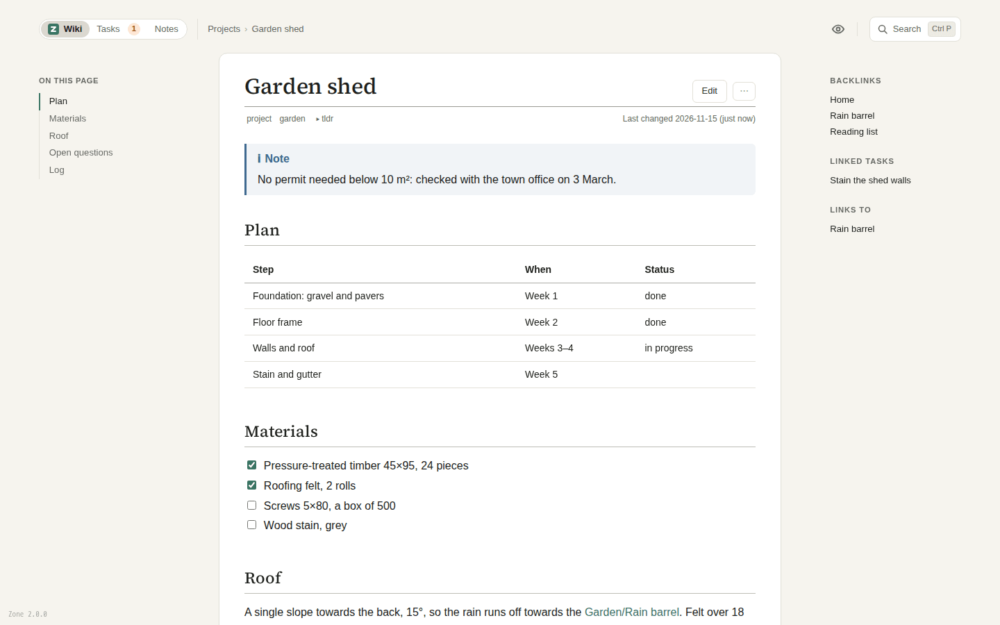

# Pages

A page is the basic unit of your wiki: one Markdown file, with a title, text and links to other pages.
This page covers what a page shows, how you make, link, rename, move, share and delete pages,
and the extras a page can carry: tags, a summary, sources and uploaded files.

## What a page is

Every page is a Markdown file in your wiki's folder.
Its **title** is the first `# Heading` in the file.
Its **name**, also called its slug, is the file name without `.md`: lowercase, with hyphens for spaces.
A page titled "Garden shed" is usually the file `garden-shed.md`, and its address is `/page/garden-shed`.

Pages can live in **folders**.
`projects/garden-shed.md` is the page `projects/garden-shed`, and you link to it by that name.
A folder needs no setting up: it exists as soon as a page is in it.
Some folders are special when your wiki has several users:
`private/<you>/` holds pages only you see, and `groups/<name>/` holds a group's pages (see [Teams](teams.md)).

Because pages are plain files, you can also edit them in any text editor on disk.
Zonewiki picks up the change (see [uncommitted changes](history.md#uncommitted-changes)).

## The page view



### The header and the page menu

At the top of every page are its title, an **Edit** button (or press `e`) and a **⋯** button that opens the page menu:

| Entry | What it does |
|---|---|
| **Present** | shows the page as slides, one per heading (also `p`; only on pages with headings) |
| **History** | every saved version of the page (see [History and undo](history.md)) |
| **Print…** | the browser's print dialog, where you can also save a PDF |
| **Watch** | tells you when someone else changes the page (with users; see [Watching pages](history.md#watching-pages)) |
| **Share…** or **Make shared…** | moves one of your private or group pages to more readers (below) |
| **Rename…** | gives the page a new name or folder (below) |
| **Delete…** | deletes the page after asking (also Ctrl+Delete) |

Under the title, a row shows the page's tags, a **tldr** switch for its summary, and **Last changed** with the date.
A private page shows 🔒 beside its title, a group's page 👥 and the group's name.

### Copying a link

Hover over the title or a heading and a small link icon appears after it.
Click it to copy the address of the page, or of that section with its `#anchor`.
"Link copied" confirms it.

### Contents and connections

On a wide screen (from about 1320 pixels) the page uses the room on either side:

- **On this page**, on the left, lists the page's `##` and `###` headings once it has at least three.
  The section you're reading is marked, and **↑ Back to top** appears once you scroll down.
- On the right are the page's connections:
  **Backlinks** (pages that link here), **Linked tasks**, **Related**, **Links to** (the pages this one links to) and **Files** (the files it links to or shows).

On narrower screens the connections are at the end of the page instead,
and a `← 3` chip at the right of the top row says how many pages link here.
Hover it (or tap it on a phone) to see them.

### Backlinks and linked tasks

- **Backlinks** lists every page with a link to this one, wikilink or ordinary Markdown link.
  "No pages link here." when there are none.
- **Linked tasks** lists the open tasks whose title or description links to this page.
  A task that links to one section also puts a `☑ 1` chip on that section's heading, listing its tasks.

### Files

**Files** lists the files the page links to or shows, images included, each with its size: click one to open or download it.
A small icon before each name says what kind of file it is: a picture, sound or video, a document, a spreadsheet, an archive, or any other file.
A file you put on the page (pasted, dropped or attached in the editor) is listed as soon as the page links to it, and a file stops being listed when its link is gone.
It lists only files you may open, and none that isn't there; with no files on the page there's no **Files**.
The full rules are in [Side columns](../spec/routes.md#files).

### Folding sections

Every `##` and `###` heading with text under it has a small chevron.
Click it to fold the section away; the heading then shows a wavy line with **folded** in it, which you click to open it again.

- Alt+click folds or unfolds every section at once.
- Press `z` to fold all sections, and again to unfold them.
- `]` and `[` jump to the next and previous section.

Folding is only for viewing: the file doesn't change, and every page opens unfolded.
Find in page, a link to a section and printing all open folded sections.

## Making a page

Most pages start as a link.

1. On any page, write a link to the page you want, such as `[[Garden shed]]`, and save.
2. The link shows as a red link, because the page doesn't exist yet.
3. Click it. The editor opens for the new page with its title filled in.
4. Write, then click **Done**. The page now exists, and the link turns normal.

This way every page is linked from somewhere and easy to find again.

Two other ways in:

- From a note: **Move to wiki…** in the note's ⋯ menu turns it into a page (see [Notes](notes.md)).
- Your private home and a group's home have a **New page** button.
  It asks for the page's name and, if you're in a group, whom it is **For**: everyone, one of your groups, or only you.

## Linking pages

### Wikilinks

A **wikilink** is a link to another page by its name, in double brackets:

| Write | Links to |
|---|---|
| `[[Garden shed]]` | the page `garden-shed` |
| `[[projects/garden-shed]]` | a page in a folder |
| `[[Garden shed\|the shed]]` | the same page, shown as "the shed" |
| `[[Garden shed#Roof]]` | the section "Roof" on that page |
| `[[#Roof]]` | the section "Roof" on this page |

You rarely type a name in full: in the editor, `[[` opens a list of pages to pick from (see [Writing](writing.md#completing-links)).
Ordinary Markdown links like `[the shed](/page/garden-shed)` work too, and count as backlinks.

### Red links

A link to a page that doesn't exist yet is shown in red.
Clicking it opens the editor so you can write the page right away.
Red links are a to-do list for your wiki: pages someone thought should exist.

### Links between private and shared pages

With several users, a link only works for people who can see its target.
A link from a shared page to your private page is marked 🔒 for you; everyone else sees plain text.
On a private page, a red link that would make a shared page is marked 🌐, and the editor offers to make the new page private instead.
[Teams](teams.md) explains private and group pages in full.

## Renaming a page

Choose **Rename…** in the page's ⋯ menu (or **Rename…** in the editor's toolbar), type the new name and click **Rename**.
You can type a title like "Garden Shed 2027"; Zonewiki turns it into a name.

Every link to the page follows: wikilinks keep their label, Markdown links keep their style and anchor.
Links in code are left as written.
The page's history follows it to its new name.

Zonewiki refuses a name another page already has; nothing is overwritten.
The home page can't be renamed.

## Moving a page into a folder

A move is a rename with a folder in the name.
Rename `garden-shed` to `projects/garden-shed` and the page is in the folder `projects`, which is made if needed.
Links to it follow, and the page's own relative links are adjusted so they still lead to the same places.

## Sharing a page with more people

Where a page is kept says who sees it.
On one of your private pages, **Make shared…** in the ⋯ menu moves it into the shared wiki, where everyone who uses the wiki sees and changes it.
If you're in a group, the entry is **Share…** and also offers your groups' folders, each with the people who would then see the page.
Links to the page follow, and so do the files it shows.

Moving a page to *fewer* people is different:
only an admin may do it, or whoever shared the page as long as nobody else has changed it.
A rename into another place says who will see the page before it asks **Yes, move it**.
The full rules are in [Teams](teams.md).

## Deleting a page

Choose **Delete…** in the ⋯ menu (or press Ctrl+Delete, or **Delete** in the editor) and confirm.
Links to the page turn into red links.

Deleting isn't final: the page stays in the wiki's history,
and **Deleted Pages** brings it back with one click (see [History and undo](history.md#deleted-pages)).
The home page can't be deleted.

## The home page

Your wiki's home page is the page `index`, the file `index.md`.
The logo and **Wiki** at the top left lead to it, and so does `g` then `h`.
It's an ordinary page: put on it whatever helps you find your way, such as links to your main pages.
It can't be renamed or deleted.

With several users, your private home (`private/<you>/index`) and each group's home (`groups/<name>/index`) work the same way.
Zonewiki makes each the first time you open it.

## Frontmatter

A page may start with a block between two `---` lines, called **frontmatter**, that holds facts about the page:

```markdown
---
tags: garden, project
tldr: A 2×3 m shed at the back of the garden, built over five weeks.
sources: [[Garden budget]], https://example.com/shed-guide
---
# Garden shed
```

| Key | What it's for | How it shows |
|---|---|---|
| `tags:` | the page's tags, comma-separated or one `- tag` per line | pills under the title; click one to search for the tag |
| `tldr:` | a short summary | a **tldr** switch under the title that shows it |
| `sources:` | where the page's facts come from: URLs, `[label](url)` or `[[page]]` | a **Sources** list at the end of the page |

Other keys are kept but ignored.
You edit frontmatter as text in the editor; there's no separate form.
Dates aren't needed: the page's history knows when it changed.

## Uploads and images

To add a file or image to a page, paste it or drag it into the editor, or click **Attach** in the formatting bar.
Zonewiki uploads it and writes the link for you:
an image as ``, which shows the image, any other file as `[name](url)`, a link to download it.

- Files are kept in an `_assets/` folder next to the pages: the wiki's own, or your private folder's or a group's for a page there, so they're seen by the same people as the page.
- A pasted screenshot gets a unique name. A file whose name is taken asks whether to replace it, use another name, or cancel.
- Your admin may set a size limit for uploads.

Click an image on a page to see it full size.
Set an image's width with `|` and a number of pixels in its description: ``.

An image from another website isn't loaded, so a page can't leak what you read to other sites.
It shows as a link marked 🖼 instead, unless the person running your Zonewiki allowed that site.
