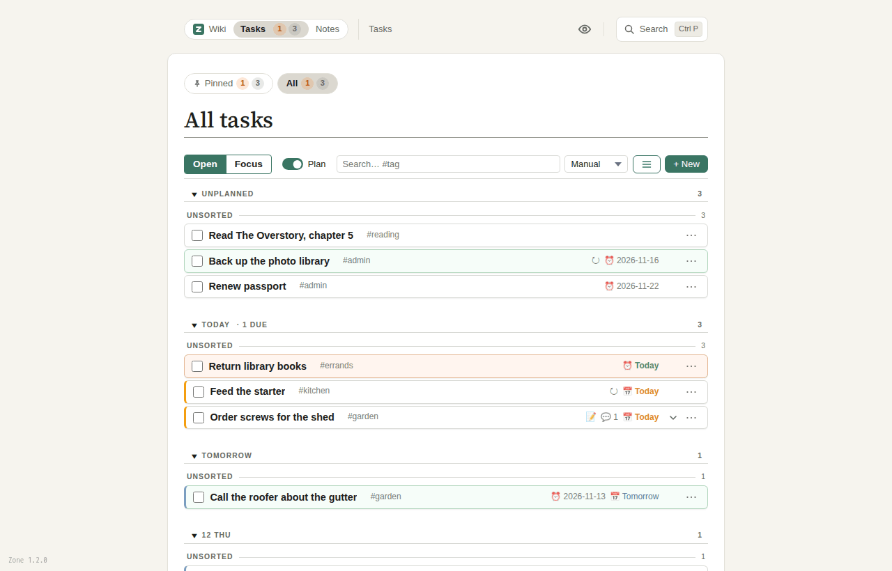

# Tasks

Zonewiki has a task app beside the wiki: what you have to do, when you plan to do it, and by when it must be done.
It is a task manager in its own right, with a board to plan your days, lists, repeating tasks and, in a team, assignees and comments, so you need no other one beside your wiki.
This page covers making and planning tasks, lists and who sees them, assigning tasks to others, and showing tasks on a wiki page.
Tasks share the wiki's links and search, so a task can point to a page and a page can show its tasks.



## What a task is

A task has a **title** and, if you like, more:

| Part | What it is for |
|------|----------------|
| Description | Notes in Markdown, as on a page. `- [ ] item` lines are checkboxes: a task's subtasks, counted on its card ("☑ 1/3"). |
| Tags | One word each, such as `#work` or `#garden`. A tag sorts tasks across lists; it never moves a task. |
| List | The place the task is in, such as `shop` or `team`. A task is in exactly one list (see [Lists](#lists)). |
| Start date | The day you mean to work on it. From that day on it is on Today. |
| Due date | The deadline. Only a past due date makes a task overdue (red). |
| Importance | High (**!** before the title), Normal, or Low (**↓**, the title in grey). It marks a task; it never changes the order. |
| Assignee | With several users: who does it (see [Assigning tasks](#assigning-tasks)). |

The two dates are independent: moving one never moves the other.
A start date in the past isn't a warning: the card says "since Sep 21", and the task is on Today until it's done.
If you plan a task to start after its deadline, Zonewiki asks **Move the deadline too?**, but never forbids it.

### Keep tasks

A **keep task** isn't archived when you tick it off: it goes back to Open, ready for next time.
That suits a shopping list: Open is the catalogue of staples, Today is what to buy now, and ticking an item off puts it back in the catalogue.
Its card shows ⟲ and when it was last done ("✓ Sep 21").
Turn it on with **+ Keep after done** in the task's dialog, and use **Won't do** to retire a staple for good.

### Repeating tasks

A task that comes back is a series.
In the task's dialog choose **+ Repeat**, then **Daily**, **Weekly**, **Monthly** or **Yearly**, and how often ("**Every** 2 weeks").
A repeating task needs a due or start date, which the series steps from.
Tick **From done** to count from the day you finish it instead of from the date.

When you complete a repeating task, the next one appears with its dates moved on, keeping the gap between start and deadline.
**Skip this occurrence** in the ⋯ menu drops one occurrence and brings the next one after today, so a missed daily task doesn't pile up.
Reopening the task you just completed removes the next one again, as long as you haven't changed it.
A keep task can't repeat: both say what happens after done.

## Making tasks

- **c t** on any page opens a new task in your **Inbox**, starting today; you stay on the page.
  On a phone, the **Task** button in the bottom bar does the same.
- **+ New** (or **n**) in a task list makes a task there: in that list, with its tags, and starting today when you are on the Today tab.
- **Make a task** in the editor's formatting bar turns lines of a page into tasks and puts references to them in their place, handy for action items in meeting notes ([Make task](../spec/rendering.md#make-task)).
- Your assistant can make tasks too (see [AI assistants](assistants.md)).

The dialog says under the title where the task goes, and with several users who will see it ("Adds to your Inbox: only you see it.").
A new task goes on top of the list, where you see it; drag it (or press **Ctrl+Shift+↓**) to where it belongs.

### Quick-add

At the end of a new task's title you can type shorthand, and the fields below follow as you type:

| Type | Sets | Example |
|------|------|---------|
| `today`, `tomorrow` or `tmrw` | the start date | `Call Ben tomorrow` |
| a weekday | the start date: the next one, never today | `Water plants fri` |
| `+3`, `+3d`, `+2w` | the start date, counted from today | `Renew passport +2w` |
| `2026-12-01` | the start date | |
| `due:` and any of the above | the due date | `Q3 plan due:fri` |
| `#word` | a tag; a word that names one of your lists puts the task in that list instead | `Milk #shop` |
| `@name` or `@me` | the assignee (with several users) | `Review draft @anna` |
| `!` or `!high`, `!low` | the importance, as a word of its own | `Pay rent !` |

Only words at the end count, and a word that would leave the title empty stays in it.
Changing a field by hand takes its word out of the title.

## The views

A task list has two tabs, **Open** and **Today**, and a link to the closed tasks.

- **Today** is what you're working on now: tasks that start today or earlier, are due today, or are overdue.
  It is worked top to bottom.
  With a work-in-progress limit set, it warns when it gets too full.
- **Open** is every open task.
- **Closed (N) →** under the list shows the tasks you finished or closed as won't do, latest first, 50 at a time (**Show more**).
  A year switcher reaches older years.
  **← Back to Open** (or Today) returns.

Which tab a list opens on depends on what it is: your own tasks open on Today, a shared list or your Inbox on Open.
**Tab** and **Shift+Tab** switch tabs.

### Ways to show a tab

The control next to the tabs (or **d**) picks how the tasks are grouped:

| Choice | Shows | Dragging a card onto a section |
|--------|-------|-------------------------------|
| **List** | One list in your order, a new task on top | puts it there in the order |
| **Plan** | A board by start date: Unplanned, Today, Tomorrow, the next days, Later (Open tab only) | sets its start date |
| **By person** | A section per assignee: Unassigned, You, then everyone else (with several users) | assigns it |
| **By list** | A section per list, the Inbox first (where a view holds several lists) | moves it to that list |

On the Today and Open tabs the **Order** menu (or **o**) sorts by **Manual**, **Due date** or **Created**.
Only Manual can be reordered by dragging; the others are for reading.
A sort lasts while the browser tab is open; a new one starts in Manual again.
The manual order is one for everyone: where you drag a task in a list, it is for all who see the list.
In **My tasks** the menu says **My order** instead: that order is yours alone ([My tasks](#my-tasks)).

### Planning your week

The Plan board is where you decide when to do things.
Drag a card from **Unplanned** onto a day to start it then, onto **Unplanned** to unplan it, or onto **Later** to pick a date a week or more away.
Within a day you can drag cards into order too.

Each day's header counts its tasks and how many are **due** that day, wherever their cards sit; click the count to see them.
Unplanned counts its overdue tasks, and Today its **carried** ones: tasks started on an earlier day and still open.
Click a header to fold a section, for example a long Unplanned backlog.

You don't need the mouse: select tasks and press **1**–**7** to start them on that day of the board (1 is today, 2 tomorrow), **0** to unplan, or **f** / **F** for today and tomorrow.
These work on every tab, on several selected tasks at once, and come with one undo.
The full rules are in [the Plan board](../spec/tasks.md#the-plan-board).

## Working with tasks

### Opening and editing

Click a task to select it; a long title then shows whole.
Click the chevron, 📝 or 💬 on its line (or press **→**) to show its description and latest comments under it.
Double-click a task, or press **Enter**, to open its dialog.
On a touch screen, tap once to select and tap again to open.

The dialog shows Title, Description, Tags, List, Due, Start and Importance.
Rarer fields are offered in a line underneath: **+ Assignee**, **+ Repeat**, **+ Days before due** (another way to set the start date) and **+ Keep after done**.
The description has the editor's formatting bar and **Edit** | **Preview** (**F2**).
**Save** (or **Ctrl+Enter**) saves; if two people edit the same task, only the fields you changed are saved.

### Completing

Tick the checkbox to complete a task.
It is struck through for a moment, so you can still change your mind, then it moves to Closed.
If its description still has open checkboxes, Zonewiki asks first (**Complete anyway**).

A task you won't do is closed with **Won't do** (⋯ menu, the dialog, or the **Delete** key): it goes to Closed marked "✗ won't do" and can be reopened from there.
Tasks are closed, not deleted.
Who made a task (or an admin) can remove a closed one with **Delete for good…** in its ⋯ menu, for a task made by mistake.

Most actions show a notice with **Undo**; **Ctrl+Z** does the same while it shows.

### Quick actions

The **⋯** on every card (or a right-click) has: **Edit…**, **Start today**, **Start tomorrow**, **Pick start date…**, **Unplan**, **Skip this occurrence** (repeating tasks), **Importance…**, **Move to list…**, **Assign…** and **Follow** (with several users), **Won't do**, **Copy link** and **Select several**.
The ⏰ and 📅 on a card open a date picker with shortcuts: **Today**, **Tmrw**, **+2d**, **Mon**, **+1w**.
**Copy link** gives a link that opens the list with that task selected, to paste into chat, mail or a page.

### Selecting several tasks

**Shift+click** selects a range, **Ctrl+click** (Cmd on a Mac) adds one, and **Ctrl+A** takes every task shown.
On a phone, long-press a card (or **Select several** in ⋯) and tap the others.
A bar at the bottom then acts on all of them: **All**, **Tag…**, **List…**, **Assign…**, **Today**, **Unplan**, **Done** and **Won't do**.
**Tag…** (or **t**, and **T** to remove) shows each tag the tasks carry with a three-way box: on all, on some, or removed.

### Filtering a list

Type in the filter field (**/**) to narrow the list:

| Word | Shows the tasks |
|------|-----------------|
| any text | with it in the title or description |
| `#work`, `#a\|b`, `-#work` | with the tag, with either tag, without it |
| `list:shop`, `-list:shop`, `list:inbox` | in that list, not in it, in your Inbox |
| `!high`, `!low` | of that importance |
| `@anna`, `@me`, `@none` | assigned to Anna, to you, to no one (with several users) |
| `from:me` | that you made (with several users) |
| `is:updated`, `is:following` | with news for you, that you follow |

A new task made while filtering gets the filter's tags.
The full syntax is in [Filtering](../spec/tasks.md#filtering); to search tasks and pages together, see [Search](search.md).

## Lists

A **list** is a place a task is in: `shop`, `team`, `garden`.
A tag sorts tasks; a list holds them.
A task is in one list and can have any number of tags.

The Tasks page has a row of pills at the top: **My tasks**, in a wiki with users **Updates** ([News about your tasks](#news-about-your-tasks)), **Inbox**, your pinned lists, and **More ▾** with every other list and **All tasks**.
Each pill counts what is due today or overdue there.
The pill you pick is remembered: go to the wiki and click Tasks again, and you are back on it.

### Making a list

Choose **New list…** in the ⋯ menu beside the Tasks page's heading, give it a name, and it opens, pinned as a pill.
You can also make one from a task's **List** field or from **Move to list…**.
A name is one lowercase word; spaces become `-`.

Put a task in a list with the **List** field of its dialog, **Move to list…**, or **m** on selected tasks.
Moving a task out of your Inbox into a list is called filing it.

### Who sees a list

With several users, a list is in a place, as a page is, and **For** in **New list…** chooses it:

| For | Who sees it and its tasks |
|-----|---------------------------|
| **Everyone who uses this wiki** | everyone |
| **@dev: its members see it** (one of your groups, 👥) | the group's members; the list is kept in the group's folder |
| **Only you** (🔒) | you alone |

Whoever sees a list sees and changes its tasks.
A task is as private as its list: moving a private task to a shared list asks first, because it can't be made private again.
**Make shared…** in a private list's ⋯ menu shares the list with its tasks, with everyone or one of your groups; there is no way back.
**Who sees it…** moves a shared list to everyone or to one of your groups, its tasks with it.
Moving a task to a list that fewer people see is only for who made it or an admin.
The full rules are in [Private lists](../spec/tasks.md#private-lists), [A group's lists](../spec/tasks.md#a-groups-lists) and [Teams](teams.md).

### The Inbox

The **Inbox** is the list everyone has without making it: a new task goes there unless it is made in a list or names one.
With several users your Inbox is yours alone, so what you capture stays private until you file it.
It can't be renamed, deleted or shared.

### My tasks

**My tasks** is your home view, where the Tasks link in the top bar goes and what its badge counts.
It holds what is yours to do: the tasks in your own lists (your Inbox, your private lists) and the shared tasks assigned to you.
An unassigned task in a shared list belongs to that list's backlog, not to everyone's My tasks; the list's heading shows "N unassigned", a link to all of them on the list's **Open** tab.
What you rank in My tasks is your own order, **My order** in the **Order** menu, and changes nothing in the lists.
A task that is new to you (one just given to you, one you just made) is on top there until you drag it into place.
An assistant asked to "put this first for me" ranks in the same order ([details](../spec/tasks.md#my-tasks)).
"Given to others: N" links to the tasks you made that someone else has.

### Pins and list settings

A pin only makes a list a pill: **Pin** and **Unpin** are in the list's ⋯ menu, and you drag pills to reorder them.
Pins are your own: a list you make is pinned for you, and a list someone else made is under **More** (your lists first) until you pin it.

**List settings…**, first in the ⋯ menu, sets how a list behaves for everyone who looks at it:

| Setting | What it does |
|---------|--------------|
| Opens on | The Open or the Today tab |
| The Open tab shows | List, Plan, By person or By list |
| WIP limit | Today warns at this many tasks; Plan's days turn amber |
| Tab names | Your own words for the tabs, such as Catalogue and Shopping |
| Tags of a new task | The tags a new task in this list gets |
| Keep tasks | New tasks here are keep tasks |
| Hide when sharing | Leaves the list out while sharing your screen |
| Leave out of My tasks | Your list's tasks stay out of My tasks and its count (a someday list) |

Only the first two show at first; the others are offered as "+ WIP limit" and so on.
On a wiki page that shows the list, **Opens on**, **The Open tab shows** and the filters are that page's own, written into its `[[tasks: …]]`; the rest is the list's wherever it shows.
The same menu has **Rename…**, **Who sees it…** and **Delete…**, for the list's owners (who made it) and admins.
Deleting a list keeps its tasks: the dialog asks which list they go to, or offers to close the open ones as won't do.

## Assigning tasks

With several users, a task in a shared list can be assigned to one person: who does it.
Assigning never changes who sees or may change the task.

- In the dialog, type in **Assignee** (`@` lists everyone); in a new task's title, end with `@name`.
- On selected tasks, **Assign…** (or **a**) assigns them all at once, or to **No one**.
- On the board **By person**, drag a card onto someone's section.

A private task has no assignee.
A task for someone else needs a shared list: when you name someone on a new task in your Inbox, the dialog asks which shared list it goes to.
When you share one of your own tasks, Zonewiki assigns it to you, so it stays in your My tasks.
A task whose assignee has left (or lost access to the list) shows the name struck through and counts as no one's.
The full rules are in [Assigning tasks](../spec/users.md#assigning-tasks).

### News about your tasks

You are told what happens on a task you are assigned, made, or follow: someone gave it to you, commented, mentioned you, closed or reopened it, or gave it to someone else.

- **On the card** a mark says what happened: **new**, **anna commented**, **ben closed it**, in every list.
  Opening the task takes the mark away.
- **Updates**, beside **My tasks** in the row of lists, holds every task with news, the latest first, also the ones that aren't yours to do.
  Its number is how many there are; in My tasks a line, **2 updates for you →**, leads there.
- **Reading one**: open the task, or click **Mark read** on its card in Updates; **Mark all read** beside the heading clears them all.
  A task you have read stays in Updates, dimmed, until you leave the page.
- **On the Tasks link** a dot says there is news (pointing at it says how many tasks have some).
- **Follow** in a shared task's ⋯ menu or dialog tells you its news without making it yours to do.
- **Mentions**: `@name` in a comment or description tells that person, even on a task they have nothing else to do with.
- **Mail**: in My tasks' **List settings…**, **Mail me when** has three boxes: a task is given to me, someone mentions me, someone comments on a task I have, gave or follow.
  None is on until you tick it, and they show only where Zonewiki can send mail.

## Comments and history

A task's dialog ends with **Comments**: click **Write a comment…** (or **Alt+C**), write, and press **Ctrl+Enter** or **Add**.
A comment is saved at once, not with the task, and keeps its line breaks.
It can use Markdown, links and files.
You can edit (✎) or delete (×) your own comments.
A card shows 💬 with the number of comments; its details show the latest three.

**History**, a folded section in the dialog, lists what happened to the task and, with several users, who did it: created, start and due dates changed, done, reopened, won't do, skipped, assigned, mentioned, shared.
Title and tag edits aren't listed; the wiki's git history keeps everything (see [History and undo](history.md)).
A repeating task's history runs across the series; each occurrence keeps its own comments, and **The occurrence before →** leads to the previous one.

## A task's files

Paste, drop or attach a file in a task's description or a comment, and it is uploaded with the task.
With several users the file belongs to the task: whoever sees the task sees the file, and nobody else.
A file pasted in a new task's dialog is yours alone until you save the task, and a task deleted for good takes its files with it out of everyone's sight (**Undo** brings them back).
It stays with the task when the task moves to another list.

## Tasks on a page

### Showing a task list

Put `[[tasks:]]` on a line of its own, and the page shows a full task list there.
Parameters after the colon choose what it shows:

| Parameter | Example | Shows |
|-----------|---------|-------|
| `list` | `list=shop` | That list, with its settings; new tasks go into it. `list=inbox` shows each reader their Inbox. |
| `mine` | `mine=1` | My tasks, for whoever looks |
| `tag` | `tag=work,-urgent` | Tasks with these tags, in any list: `,` both, `\|` either, `-` without |
| `assignee` | `assignee=me` | Tasks of that person; `me` is whoever looks, `none` no one |
| `view` | `view=today` | Opens on `today`, `open` or `closed` |
| `group` | `group=person` | How Open shows its tasks: `none`, `day`, `person`, `list` |

The rest comes with what the list shows: a list's WIP limit, tab names, keep tasks and the tags of a new task are set in the list's **List settings…** and hold on every page that shows it; a list of no list or of My tasks takes those of All tasks or of your My tasks.

For example:

```markdown
[[tasks: list=shop view=open]]
[[tasks: tag=garden group=none]]
[[tasks: list=team view=today group=person]]
[[tasks: assignee=me]]
```

You don't have to type it: the editor's **Task list** button writes it for you ([the task list dialog](../spec/editor.md#task-list-dialog)), and **List settings…** in the embed's ⋯ menu changes it.
A page that shows a list is listed on the list's page as a backlink; removing the embed or the page doesn't touch the list.
All parameters are in [Task list embed](../spec/tasks.md#task-list-embed).

### Pointing to one task

`[[task:…]]` shows a single task inline as a chip with its checkbox, title, dates and list; you can tick it right on the page.
Type `[[task:` in the editor and pick the task by its title: Zonewiki fills in its id.
A repeating task's chip always shows the current occurrence.

The other way round, a `[[wikilink]]` in a task's title or description lists the task under the page's **Linked tasks**.

## Renaming a tag

Open the tag's view, such as `/tasks?tag=garden`, and choose **Rename tag…** in the ⋯ menu.
Zonewiki renames it on every task and in the pages' `tag=` embeds and links, in one change you can undo.
Renaming to a tag that already exists merges the two, after asking.

## Export and import

**Export tasks** in a list's ⋯ menu downloads its tasks as a JSON file, open and closed, with descriptions, comments and history; it is there for everyone who sees the list, a viewer too.
**Import tasks…** reads such a file into the list you are in, if you may add tasks to it; you can give the imported tasks a tag of your own, to find them again.
A task already in the wiki is skipped, so importing twice adds nothing, and the notice has **Undo**.
A plain JSON list such as `[{"title": "Buy seeds"}]` works too.
See [Export and import](../spec/tasks.md#export-and-import) and [Your data](your-data.md).

## Keyboard and touch

The main keys in a task list (**?** shows them all):

| Keys | What they do |
|------|--------------|
| **c t**, **n** | New task in your Inbox; new task in this list |
| **j** / **k** or **↓** / **↑** | Next / previous task (with **Shift**, select along the way) |
| **Enter**, **Space**, **Delete** | Open, complete, won't do |
| **→** / **←** | Show / hide the description and comments |
| **f**, **F**, **1**–**7**, **0** | Start today, tomorrow, on that day of the board; unplan |
| **i**, **t** / **T**, **m**, **a** | Importance; add / remove tags; move to a list; assign |
| **Ctrl+Shift+↑** / **↓** | Move in the manual order |
| **d**, **o**, **Tab** | Grouping; order; next tab |
| **/**, **#**, **@** | Filter; filter by tag; filter by person |
| **Ctrl+Z** | Undo the last action, while its notice shows |

On a touch screen:

| Gesture | What it does |
|---------|--------------|
| Tap, tap again | Select (and show a long title); open the dialog |
| Swipe right | Start today |
| Swipe left | Unplan (clear the start date) |
| Long-press and drag | Move the card, onto a day, a section or a place in the order |
| Long-press and let go | Select several |

The full lists are in [Keyboard shortcuts](../spec/tasks.md#keyboard-shortcuts) and [Touch](../spec/tasks.md#touch); see also [Getting around](navigation.md).
