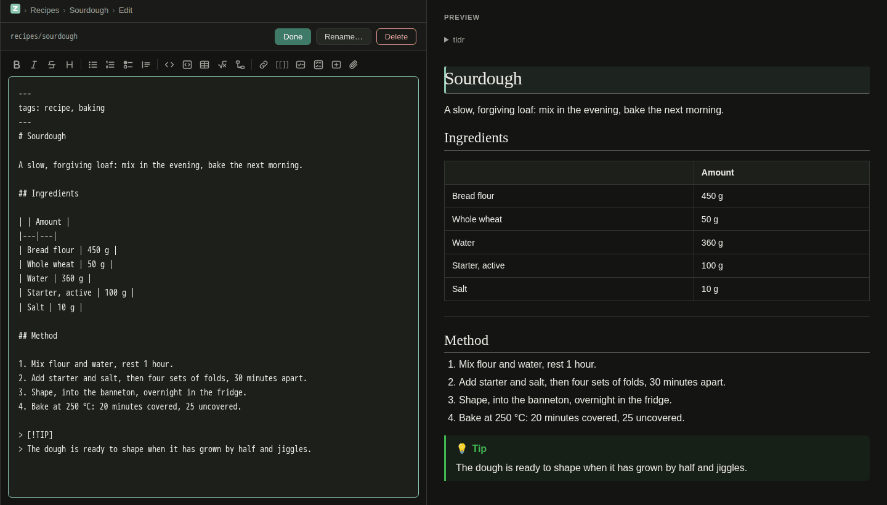
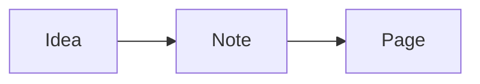

# Writing

Zonewiki's editor is a plain Markdown editor with a live preview: you write text, Zonewiki saves it as you go and shows how it will look.
This page covers the editor and its helpers, what happens when two people edit the same page,
and then the Markdown Zonewiki understands, including what it adds to the usual syntax.

## Opening the editor

- On a page, click **Edit** or press `e`.
- To change just one part of a long page, click the ✎ beside a section's heading (see [Editing one section](#editing-one-section)).
- Click a red link to start a new page.

The editor shows your text on the left and a live **Preview** on the right, updated as you type.
F2 hides or shows the preview.



## Saving

You don't need to save by hand.

- **Auto-save**: two seconds after you stop typing, Zonewiki writes your text to the page's file.
  A dot ● in the toolbar shows while there are changes not yet written.
- **Done** (or Ctrl+S) saves, records the page as a new version in its history and takes you back to the page.
- Leaving the editor any other way, by a link or the browser's Back button, saves what you typed too.

Auto-save keeps your text safe, but only **Done** makes a version in the page's history.
Text that's auto-saved but not yet Done counts as an [uncommitted change](history.md#uncommitted-changes).

There's no Cancel button.
To take back what you typed, undo with Ctrl+Z, or restore an earlier version from the page's [history](history.md).

The toolbar also has **Rename…** and **Delete**, which work as in the page's ⋯ menu (see [Pages](pages.md#renaming-a-page)).

## The formatting bar

The row of buttons above the text helps you write Markdown; it doesn't hide it.
Each button works on the selected text or the line the cursor is on, and one Ctrl+Z undoes it.

| Button | What it does | Key |
|---|---|---|
| Bold, Italic | wraps the selection in `**` or `_` | Ctrl+B, Ctrl+I |
| Strikethrough | wraps the selection in `~~` | |
| Heading | turns the line into `##`, then `###`, then back to text | |
| Bulleted list, Numbered list, Checklist | makes the selected lines a list, or removes the list | |
| Quote | quotes the selected lines | |
| Inline code, Code block | marks text as code | |
| Table | inserts a small two-column table | |
| Math | inline `$…$`, or a `$$` block on a blank line | |
| Diagram | inserts a Mermaid diagram to start from | |
| Link | makes the selection a link, opening the page list | Ctrl+K |
| Link to a wiki page `[[]]` | a wikilink, opening the page list | |
| Link to a task | a reference to one task, opening the task list | |
| Task list | embeds a list of tasks (see [Task lists](#adding-a-task-list)) | |
| Make a task | turns the line or selection into tasks | |
| Attach | uploads a file or image from your device | |

On a narrow window the bar scrolls sideways.

## Helpers as you type

### Completing links

| Type | You get |
|---|---|
| `[[` | a list of pages, narrowed as you type |
| `[text](` | the same list, inserting a `/page/…` link |
| `[[task:` | a list of open tasks, by title |

Use the arrow keys and Enter or Tab to pick one, Esc to close the list.

With several users the list adapts to where you are writing.
On a private page it ends with **New private page: …**, and on a group's page it starts with **New page for @group: …**.
On a shared page your private pages aren't offered, since others couldn't follow the link.

### Emoji

Type `:` and two letters, such as `:smi`, to get a list of emoji; pick one and the emoji itself goes into the text.
A full name like `:tada:` turns into 🎉 when you type the closing colon.

### Lists and checkboxes

- Press Enter at the end of a list item and the next one starts with the same marker (the next number in a numbered list).
  Enter on an empty item ends the list.
- A checklist item is `- [ ] text`, ticked `- [x] text`.
  Ctrl+Shift+X ticks or unticks the item on the cursor's line.
- You can tick a checkbox in the preview, and on the page itself without opening the editor.
  Zonewiki notes when it was ticked as a small date chip, and offers **Undo**.

### Snippets

Type one of these words and press Tab:

| Type | Becomes |
|---|---|
| `/date` | today's date, like `2026-03-22` |
| `/time` | the time, like `14:05` |
| `/datetime` | both, like `2026-03-22 14:05` |

### Pasting a link

Paste a web address over selected text and the text becomes a link to it.
Paste one with nothing selected and Zonewiki asks for the link's text; leave it empty to keep the plain address.

### Adding a task list

**Task list** in the formatting bar opens **List settings**, where you choose which list to show and how (tab, grouping, filter).
**Insert** writes the matching `[[tasks: …]]` line.
With the cursor on such a line, the same button opens **Change the task list** to change it.
See [Tasks](tasks.md) for what a task list on a page can do.

### Making tasks from text

**Make a task** turns text into tasks and leaves references to them in its place, handy for action items in meeting notes.
One line opens the task dialog to check it first; several lines become several tasks, one per line, sharing the tags and dates you set.
Each task's description links back to the page.

## Editing one section

On a page, each `##` and `###` heading has a ✎.
Click it to open the editor with only that section, from its heading to the next one.
Saving puts it back in its place, even if someone changed other parts of the page meanwhile.

## Pasting and dropping files

Paste a file or screenshot into the editor, drag one onto the text, or click **Attach**.
Zonewiki uploads it and inserts a link: `` for an image, `[name](url)` for anything else.
Several files dropped at once are uploaded one after another.
Where files are kept and who sees them is in [Pages](pages.md#uploads-and-images).

## The editor on a phone

On a phone the editor fills the screen.
The toolbar has a **Preview** button to switch between the text and its preview,
and **Rename…** and **Delete** move into a **⋯** menu.
The formatting bar scrolls sideways, with buttons sized for fingers, and keeps the keyboard open.

## Two people editing at once

Two people can have the same page open, and an AI assistant may write to it while you're editing.
When a save meets a change made since you opened the page, Zonewiki merges the two line by line.
If you changed different lines, both changes are kept, your text updates in place, and a note says "Merged Ben's changes".

### When changes clash

If you both changed the same lines, a banner says "Ben changed the same lines while you were editing." and offers three choices:

| Button | What happens |
|---|---|
| **Reload theirs** | loads the page as it is now; your text is first saved into the page's history, so it isn't lost |
| **Keep mine** | saves your text over theirs; their version stays in the page's history |
| **Merge by hand** | puts both into the text, between `<<<<<<<`, `=======` and `>>>>>>>` lines, for you to sort out (whole pages only) |

After **Merge by hand**, Zonewiki waits to save until the marker lines are gone, and asks before Done if any are left.

If you leave the editor while a clash is open, Zonewiki keeps your text for you.
The next time you edit the page, the banner comes back with the same three choices.
A kept text is dropped after 30 days.

## Zonewiki's Markdown

Zonewiki reads Markdown as GitHub does (GitHub Flavored Markdown), plus a few additions of its own.

### The usual syntax

| Write | You get |
|---|---|
| `# Title` | the page's title (the first one only) |
| `## Section`, `### Subsection` | headings; these get ✎, folding and a place in the contents |
| `**bold**`, `_italic_`, `~~struck~~` | **bold**, _italic_, ~~struck~~ |
| `` `code` `` | inline code |
| ` ``` ` lines around text | a code block, highlighted by language (` ```python `) |
| `- item`, `1. item` | lists |
| `- [ ] to do`, `- [x] done` | checkboxes you can tick on the page |
| `> quoted` | a quote |
| `[text](https://example.com)` | a link |
| `` | an image |
| `\| a \| b \|` lines with `\|---\|---\|` | a table |
| `---` on its own line | a horizontal rule |
| `text[^1]` and `[^1]: note` | a footnote |

### Wikilinks and tasks

| Write | You get |
|---|---|
| `[[Page name]]`, `[[Page name\|label]]`, `[[Page#Section]]` | a link to a page or section (see [Pages](pages.md#wikilinks)) |
| `[[task:1a2b3c4d]]` | one task, shown as a live chip you can tick |
| `[[tasks: list=groceries]]` on its own line | a whole task list in the page |

You don't type task ids: the editor's task completion and **Make a task** write them.
[Tasks](tasks.md) has all the options of a task list.

### Mentioning someone

In a wiki with users, write `@` and a user's name, such as `@anna`, to tell that person about the page.
Type `@` and the editor lists who can be named on this page; pick one with **Enter** or a click.
On the page the name shows as a small chip, and your own name is filled in, so you spot where you are named.
When you choose **Done**, Anna sees it on her **Updates** page, behind the bell at the top right, and gets a mail if she asked for one ([Notifications](teams.md#notifications)).
The link takes her to the place where her name is.

- She is told once: editing the page again doesn't tell her again.
- Only someone who can read the page is told, so a name on your private page tells nobody: the list is empty there, and the name stays plain text.
- You can mention a viewer too.
- Importing notes tells nobody, even where the notes hold names.

### Callouts

A quote that starts with a marker becomes a coloured box:

```markdown
> [!TIP]
> The dough is ready when it has grown by half.
```

The markers are `[!NOTE]`, `[!TIP]`, `[!IMPORTANT]`, `[!WARNING]` and `[!CAUTION]`.
A title of your own after the marker isn't supported; the quote then stays a plain quote.

### Image sizes

Add `|` and a width in pixels to an image's description: `` shows it 300 pixels wide.
It never gets wider than the screen.

### Math

| Write | You get |
|---|---|
| `$E = mc^2$` | inline math |
| `$$` on a line, the formula, `$$` on a line | a formula on its own line |
| a ` ```math ` code block | the same |

Math is written in TeX and drawn by KaTeX.
Prices stay text: `$5 and $10` isn't math, because math can't end with `$` followed by a digit.
For a literal dollar sign before a letter, write `\$`.

### Diagrams

A ` ```mermaid ` code block becomes a diagram:

````markdown

````

Mermaid draws flowcharts, sequence diagrams, timelines and more.
If a diagram has a mistake, Zonewiki shows its text with Mermaid's error under it.

### Sortable tables

On a page, click a table's column header to sort its rows: ascending, then descending, then back to the order in the file.
Columns of numbers sort as numbers.
Sorting is only for viewing and doesn't change the file.

### Links that make themselves

A web address (`https://…` or `www.…`) or an email address in the text becomes a link on its own.
Links to other websites open in a new tab; links within Zonewiki stay in the same tab.

### Raw HTML

You can write HTML in a page, and it's shown as written, with limits for safety:
scripts and forms show as text, and nothing is loaded from other websites unless the person running your Zonewiki allowed that site.
An `id` or `name` you give gets `user-content-` in front, and so does a label's `for`: a link to `#note` still finds `<a name="note">`, and in an SVG `url(#shade)` and `<use href="#dot">` still find yours, but a `<style>` of your own selects it as `#user-content-note`.
In a task's description or comment, a `<style>` shows as text ([Raw HTML](../spec/rendering.md#raw-html)).
